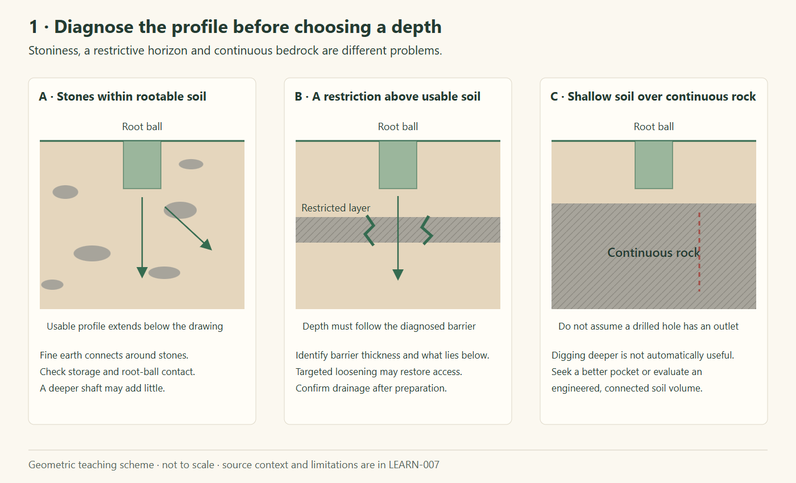
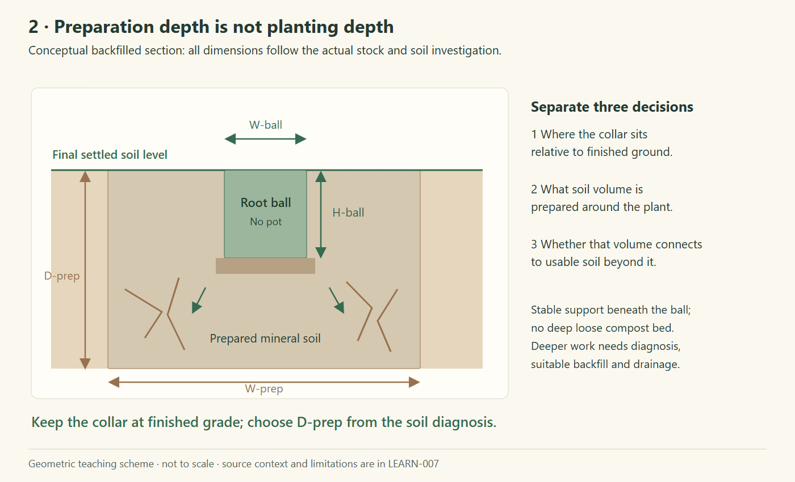
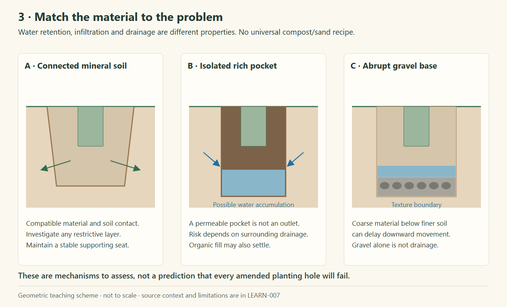
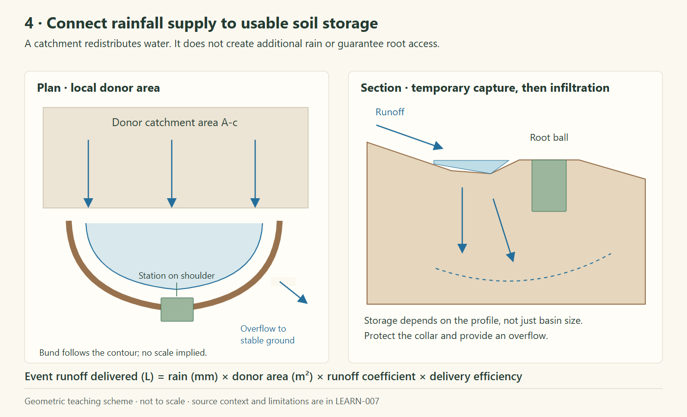

# Carob establishment: soil preparation and growth with limited water

Research date: **28 October 2026**. Species: **algarrobo / carob, *Ceratonia siliqua* L.** This report combines the repository library with agricultural and restoration literature. It is a research basis for a site trial and a future Planting Explorer, not a construction specification or an application default.

## 1. Findings that change the planting discussion

**Substantial soil preparation has a place in carob establishment. “Never prepare deeper than the root ball” is too broad a rule for restoration ground.** The position of the root collar, the excavation/preparation envelope, and the depth of genuinely usable soil are three different measurements.

For the stated objective, the useful target is **maximum sustained healthy growth within an explicit external-water budget**, while retaining ecosystem functions. Maximum irrigated orchard growth is a different objective. Excavation, imported soil and amendments can remove particular constraints; they do not replace rainfall or guarantee access to deeper water.

My proposed order of investment is:

1. Choose the best rootable microsites and inspect the soil profile.
2. Obtain healthy, suitable nursery stock and plant in a favourable moisture window.
3. Relieve a demonstrated rooting restriction, with enough lateral connection to surrounding soil.
4. Capture suitable local runoff and reduce avoidable surface evaporation.
5. Use measured establishment/rescue water where needed.
6. Add nutrients or amendments only to address a diagnosed limitation, preferably in a small comparison first.

This order is a **synthesis/proposal**, not the result of a trial comparing all six steps. The evidence and its limits follow.

### How evidence is classified

| Label | Meaning in this report |
|---|---|
| **Field experiment** | Measured treatment outcomes; check species, site, age, duration and response variable. |
| **Field demonstration** | A real planting with observations, but generally without a comparable untreated control. |
| **Technical guidance** | An institutional or expert recommendation, not proof of a universal optimum. |
| **Synthesis/proposal** | An interpretation or a suggested test for this project. |
| **Unresolved** | The reviewed evidence does not justify assigning a value. |

All diagrams below are original geometric explanations. They contain no botanical depictions, measured root distributions or predicted growth rates. Editable SVG versions accompany the PNGs.

## 2. Soil depth means more than the depth of a hole

The 2024 Biological Flora account reports that carob can occupy rocky ground with only **20–30 cm of soil**, but that shallow profiles can constrain size and productivity through poor rainwater storage and restricted rooting. Drought tolerance does not mean fast growth in a tiny soil reservoir. It also describes a substantial lateral root system and sensitivity to experimental root loss: carob should not be imagined as a single taproot using only a narrow vertical shaft. [S2], sections 2.2 and 5.3.

**Working definitions proposed for the site survey:**

- **Effective rooting depth:** depth to a barrier the roots cannot readily use, accounting for aeration, salts, compaction and rock continuity.
- **Preparation depth:** how far an operation loosens or reconstructs the soil.
- **Planting depth:** the position of the plant's root collar relative to the final, settled soil surface.
- **Connected rooting volume:** usable soil accessible both below and beside the initial root ball.

*Figure 1. Diagnostic scenarios, not measured finca profiles. A deep intervention has a different purpose in each case. [S4], [S5]; synthesis.*

| What the profile actually contains | Question to resolve | Proposed response |
|---|---|---|
| Stones dispersed through otherwise friable soil | Is there enough fine earth and moisture storage? Are the stones really preventing installation? | Prefer selective preparation and good soil contact; do not assume every stone is a defect. |
| Compacted layer or breakable cemented horizon | How thick is it? Is usable, sufficiently draining soil below it? | Consider targeted loosening/fracturing that crosses the restriction. Confirm the result. |
| Shallow soil over continuous rock | Is the rock fractured, weathered or effectively impermeable? Where can roots and water go? | Prefer deeper natural pockets or suitable fractures. Compare an engineered planting island/mound with relocating the plant. |
| Poorly draining clay or a perched wet zone | Where would additional water leave? | Resolve drainage/microsite suitability before making a collection basin or deep amended pocket. |

These are decision scenarios, not a recommendation to excavate all ground. Surface stone cover, existing native plants and undisturbed areas may already provide useful functions. Avoid equating “maximum machine access” with “maximum restoration benefit.”

### Measurements worth obtaining before specifying a depth

Use representative soil observations across the intended planting patch, including favourable and unfavourable microsites. Record horizon depths, coarse-fragment fraction, texture, visible compaction/cementation, cracks, roots already present, slope/runoff paths and signs of prolonged saturation. Sample relevant horizons for pH, electrical conductivity, organic matter and nutrients; document the laboratory's methods and units.

A simple infiltration observation is useful screening, but a rapidly draining narrow hole is not a measurement of the surrounding root zone's water storage. Dry cracks can also give a misleading first impression. Record the wetting procedure and observe the soil after an actual rain or controlled watering event. The number and depth of observations should follow site variation; no fixed investigation grid is established here. [S4], [S5]; proposed survey design.

## 3. What carob-specific planting guidance actually says

**Technical guidance, close geographical match.** The 2026 UCOPress handbook's carob “oasification” model addresses arid/semi-arid restoration, including Almería. It recommends **60 × 60 × 60 cm holes**, microcatchments and stone mulch; its table still includes support watering. General guidance elsewhere in the chapter calls for preparation **deeper than 60 cm for plants taller than 1 m in containers larger than 2 L**. These are contextual recommendations, not a controlled test proving an optimum. The text favours larger stock in places while the model table lists smaller stock: confirm the intended stock rather than combining all dimensions into one recipe. [S1], PDF/printed pp. 95, 131–134.

**Technical guidance, broader dryland context.** MITECO describes preparation holes of **30, 40 or 60 cm depth according to soil depth**, and subsoiling to improve infiltration and root access. It also discusses erosion consequences of preparation patterns. This supports diagnosing and treating a restriction, not indiscriminate deep cultivation. [S3], PDF pp. 3–8.

**Local-library evidence.** LAUJAR-001 specifies **5–10 cm scarification at reconstructed layer contacts**, or **20–30 cm where underlying material is compacted**, to aid infiltration and root penetration. This is mining-ground reconstruction, not a carob pit prescription. NIJAR-003 provides a **1 L carob nursery-stock example** and root-quality requirements, not field hole dimensions. [L1], PDF p. 70; [L2], PDF pp. 1, 4–6.

*Figure 2. A proposed way to explain deeper preparation without burying the plant. H-ball, D-prep and W-prep are separate variables; there is no universal multiplier between them. The deeper zone is mineral soil, not an open void or compost reservoir. [S4], [S5]; synthesis.*

### How I would translate this into candidate methods

| Method | What it tries to improve | Conditions/limits to check |
|---|---|---|
| Local planting pocket with roughened sides | Installation and initial lateral escape from the root ball | Appropriate where the surrounding profile is already usable. |
| Broader/deeper local preparation | Rootable volume in disturbed or restricted ground | Confirm drainage, stable support and connection to usable soil beyond the excavation. |
| Targeted ripping/subsoiling | Access through a restrictive layer without wholesale soil replacement | Select depth from the actual barrier; protect existing roots and assess slope/erosion effects. |
| Compatible mineral-soil reconstruction or a broad mound | Usable soil volume where soil has genuinely been lost or is very shallow | Requires material testing, interface/drainage design and erosion stability. A narrow imported-soil cylinder is not automatically a durable root zone. |
| A very deep narrow drilled shaft | A possible pathway through a specific thin barrier | Not an established general carob growth treatment. It can miss lateral needs, create unstable fill or bypass the young root ball. |

Arizona Extension specifically describes soil-filled drainage “chimneys” through **thin hardpan beside, rather than directly beneath, the root ball**, and warns that thick caliche can make this impractical. That is a conditional drainage technique, not evidence that a metre-deep central hole makes carob grow faster. [S4]

If a deeper excavation is used, the proposed installation detail is a stable mineral-soil supporting seat at the required elevation, with settled backfill and no buried collar. Check the position again after settling. “Firm support” does not mean heavily compacting the entire prepared root zone. General landscape guidance warns about settlement from over-deep excavation. [S5]

### Excavation volume is not stored irrigation water

A 0.6 m cube has a volume of **0.216 m³ = 216 L of soil volume**, not 216 L of plant-available water.

An illustrative screening calculation is:

`available water (L) ≈ soil volume (m³) × 1000 × available-water fraction of fine earth × fine-earth volume fraction`

For an **assumed**, uniform available-water fraction of 0.10 and 40% nonporous stones:

`0.216 × 1000 × 0.10 × 0.60 ≈ 13 L`

These fractions are deliberately hypothetical, not measured soil properties or carob thresholds. The calculation neglects water held in porous rock, root access, salinity effects, uneven wetting and hydraulic limitations. It explains why soil volume and texture matter, but cannot predict a watering interval. Digging deeper adds useful storage only if usable material, infiltration and root access actually result.

## 4. Backfill: compost, sand, loam, gravel and commercial additives

**There is no verified universal carob backfill recipe in the reviewed evidence.** Increasing water retention, increasing drainage and improving root penetration are different aims; a material that helps one can work against another.

*Figure 3. Possible interface problems, not predictions that every amended hole will fail. The appropriate solution follows the diagnosed restriction. [S4], [S5], [S6], [S7].*

| Material/intervention | Evidence and interpretation | Position for this project |
|---|---|---|
| Excavated mineral soil, with good contact and corrected structure where necessary | General planting guidance supports backfilling without an isolated rich organic pocket. | Starting comparison treatment where that soil is suitable; not a command to reuse contaminated or unusable spoil. [S5], [S6]. |
| Imported loam/topsoil | Texture contrasts can obstruct water movement or roots. Arizona guidance favours imported soil similar in texture to the existing soil. | Consider for genuine soil reconstruction; test material and design a broad, stable transition. [S4] |
| Mature compost | It can improve aggregation and water/nutrient retention, but salt content and the application context matter. Surface mulch and incorporated amendment are different treatments. | If justified by analysis, test a documented moderate treatment over a defined zone; do not fill the bottom of a deep hole with pure compost. [S7] |
| Sand mixed into clay | Small additions are not a reliable drainage correction and can impede drainage. Nursery potting recipes are not field backfill recipes. | No routine sand addition. Demonstrate a soil-physical benefit before specifying it. [S8] |
| Gravel layer at the bottom | A coarse layer is not an outlet. General tree guidance warns against this drainage shortcut. | Do not specify a gravel “drain” without an actual designed drainage path. [S5] |
| Surface stone mulch | Distinct from buried gravel. It is a moisture-management candidate, not a root-zone replacement material. | Compare with a suitable surface organic mulch or an unmulched reference; inspect runoff, temperature and weed response. [S7]; proposal. |
| Fertilizer | A limestone-quarry experiment found carob growth responded to fertilizer, while olive and lentisk responses differed. | Diagnose deficiency; do not assume more nutrients always give healthier growth under drought. No dose established here. [S9] |
| Hydrogel/water-holding polymer | The same experiment found physiological effects, but not a universal response across species/treatment combinations. | Optional research treatment with specified product and dose; no generic product recommendation. [S9] |
| Mycorrhizal inoculum | Positive carob nursery reports do not automatically establish an outplanting benefit; the quarry field study found no inoculum effect. | Require relevant field evidence before making it routine. [S9], [S10]. |
| Biochar or peat-rich fill | A 2026 mixed-species Moroccan study reports amendment effects depending on irrigation; species-level carob details were not available in the accessible abstract. | Research lead, not permission to import its 5% biochar or 25% peat treatments as a recipe. [S11] |

The carob nursery factsheet [S10] reports root-system treatments and mycorrhization tested primarily in nursery production, and explicitly calls for longer field evaluation. It is not an instruction to cut the taproot of purchased stock. NIJAR-003's anti-circling, moist, cohesive root-ball requirements remain useful acceptance checks. [L2]

Do not infer from a study on *Olea europaea* that the exact nursery stock, provenance or cultivar is the app's acebuche entry. Conversely, the *Pistacia lentiscus* name does match lentisk. Treatment transfer still requires a comparable site.

## 5. Rainfall capture may be a better investment than extra pit depth

**Carob-specific field evidence:** a Negev rocky-hillslope study used upslope runoff-collecting furrows with carob planted on downslope excavated mounds. Water-use observations supported the potential for local storage in the weathered substrate. This depended on runoff source areas and geology; it did not test an isolated deep compost hole or establish a transferable catchment size. [S12]

**Field demonstration:** an ICARDA/FAO Tunisia report describes carob in microcatchments, watering at installation, and **15 L/plant when water stress appeared**. It reports **78% carob survival at 18 months**. It does not report watering frequency or total water per survivor, or provide an untreated comparison. The narrative also differs on planting season—March in the activity description versus fall/winter in the results—so no precise seasonal protocol is extracted. [S13], PDF pp. 16–18, Fig. 7.

*Figure 4. Conceptual local runoff capture. The tree location is represented by a labelled root-ball rectangle, not a botanical image. Basin dimensions, catchment ratio and overflow capacity require site design. [S12], [S13]; original synthesis.*

A useful first estimate for **additional runoff reaching a planting station** is:

`runoff delivered (L) = event rainfall (mm) × donor catchment area (m²) × runoff coefficient × delivery efficiency`

An illustrative event with 20 mm rain, 10 m² donor area, coefficient 0.2 and delivery efficiency 0.8 gives **32 L**. These are hypothetical inputs, not measured finca coefficients, and exclude direct rain on the receiving station. Delivered water is not necessarily root-accessible storage: subtract overflow, evaporation and drainage below the currently rooted zone.

Proposed design checks:

- Use actual runoff paths; a vegetated patch may generate little runoff.
- Maintain a safe overflow so a storm does not breach the structure or bury the plant.
- Keep the collar at an appropriate final level; do not place it in a persistently saturated sump.
- Preserve useful cover and habitat between planting stations. Do not clear/crust an entire donor area simply to increase runoff.
- Check the effect on neighbouring plants and downslope areas. Harvested rain is redistributed water, not newly created water.

## 6. Low-water establishment: what can and cannot be quantified

The IRTA/IPGRI monograph describes occasional establishment watering in late spring/summer during the **first two years** of otherwise rainfed orchard planting. It also stresses weed competition in young orchards and notes that established carob has active shallow roots: protect lateral roots rather than planning repeated deep cultivation after establishment. These are agronomic guidance, not a seedling dose–response experiment. Its historical fertilizer and herbicide prescriptions are not adopted here. [S14], PDF/printed pp. 49, 57–58.

| Evidence | What was actually examined | Useful limit |
|---|---|---|
| Ezzine et al. 2023 [S15] | Three-year-old field trees; weekly subsurface drip at **8 L/plant/week**, monthly tanks at approximately **30 L/plant/month**, and no irrigation; physiological responses. | Not a first-summer minimum, growth optimum or comparison of hole depths. The site had a 60–80 cm calcisol over a petrocalcic horizon. |
| Metougui, Ilvesniemi & Bekkaoui 2026 [S11] | Seven tree species including carob, **50 months**, irrigation regimes and amendments; accessible abstract reports strong irrigation effects and first-dry-season mortality concentration. | Reported overall risk ratios cannot be assigned to carob alone. Full methods/species tables were not reviewed. |
| Murcia orchard study, EGU 2025 [S16] | Commercial carob orchard, irrigation treatments, soil moisture and tree physiological monitoring; reported complementary supplies of **100–200 mm/year**. | Conference abstract, orchard productivity context; neither a seedling schedule nor necessarily a small restoration-water budget. |

**Unit conversion matters:** 1 mm over 1 m² = 1 L. Therefore 100–200 mm/year equals **1,000–2,000 m³/ha/year**, or **20,000–40,000 L/year over an illustrative 200 m² gross area**. These conversions are arithmetic, not recommendations. Do not divide an orchard-area irrigation depth into a per-seedling dose without knowing the study's tree spacing and irrigation accounting.

A practical water budget should separately count:

1. Initial watering and any water used to condition backfill.
2. Scheduled establishment water.
3. Emergency/rescue applications.
4. Transport, application losses and replacement plants.
5. Captured rain, recorded separately from external water.

Choose the external-water ceiling first. Then monitor how long both the nursery ball and adjacent soil remain adequately moist after rain/application. Match observation/sensor depths to the actual ball, soil layers and advancing roots; do not copy an orchard probe depth into a small plug planting.

**No defensible universal minimum or optimum in L/week, and no reliable cm/year growth forecast for this finca, was established.** A deeper hole cannot make such values unnecessary. Check growth and survival together: a tall plant that later dies has not met the restoration objective.

## 7. Other levers for faster, healthier establishment

- **Stock quality and provenance:** inspect root form, health and moisture at delivery. Match material to the site's restoration purpose; a named fruit cultivar and a genetically diverse restoration population serve different goals. Do not select solely by shoot height. [L2]; proposed procurement criteria.
- **Competition:** reduce strong competition immediately around a new plant where it is a constraint, while retaining useful cover elsewhere. Define the treated area explicitly and observe erosion/temperature consequences. This is a targeted trial proposal, not blanket orchard clearing. [S14]; synthesis.
- **Mulch:** test a surface treatment with a clear gap around the collar; monitor wetting and temperature rather than assuming a material always helps. Keep buried amendment and surface cover as separately recorded interventions. [S7]; proposal.
- **Protection:** browsing protection and a sealed greenhouse tube are different interventions. An Almería experiment including carob found tubes were not a general survival solution for the tested species under its dry first season. Evaluate ventilation, heat and actual browsing pressure; do not assume a generic sleeve ensures faster growth. [S17]
- **Fertilization:** the quarry result supports investigating a diagnosed nutrient limitation, not copying an orchard fertilization calendar into every restoration microsite. [S9]

## 8. A small comparison before scaling up

The following is **my proposed trial**, not a validated optimum or a formal statistical power calculation.

First exclude clearly unsuitable stations and resolve any drainage issue. In comparable site blocks, randomly allocate:

| Treatment | Installation | Main question |
|---|---|---|
| A — Reference | Competent local planting preparation using suitable mineral backfill | How well does the simpler method establish plants? |
| B — Restriction relief | The same method plus diagnosed, documented deeper/broader preparation | Does preparation add growth/survival benefit for its excavation cost? |
| C — Water capture | Treatment B plus a locally designed microcatchment | Does rainfall redistribution reduce external-water need? |

Use B/C only where deeper work is justified and feasible; do not manufacture damage in an already suitable profile. Keep stock batch, installation quality, protection, mulch and nutrient inputs comparable so they do not obscure the preparation question. Test amendments separately after the physical constraint is understood.

For example, four blocks with one randomly assigned tree per treatment would require 12 trees. That is a modest learning trial, not sufficient by itself to establish a universal optimum. It is not a planting-density recommendation: allow suitable long-term space and separate catchments, or account explicitly for shared runoff between treatments. Increase replication if site variability or the decision warrants it.

Two water comparisons answer different questions:

- **Equal measured external water:** which treatment achieves more sustained growth/survival for the same allocation?
- **Equal predeclared moisture/rescue rule:** which treatment requires less external water to meet that rule? Report the resulting water differences; do not describe them as equal-dose treatments.

Record initial stock size; root-collar diameter at a permanently marked reference; height; canopy dimensions; survival; dieback; rainfall; every water application; soil moisture; work volume/time; and replacements separately. Replacements must not silently reset survival or growth records. Observe through at least the first two dry seasons, then reassess the design. Those are proposed evaluation periods, not promises that irrigation can then stop.

Choose success criteria in advance: survival, sustained diameter/canopy growth, acceptable plant condition, external L/original tree and L/surviving tree, plus excavation and material cost. A treatment that merely receives more captured runoff should report its donor area as part of its resource use.

## 9. What transfers to the app's other plants?

| Plant/group | Potentially transferable | Requires separate evidence |
|---|---|---|
| Acebuche and lentisk | Site diagnosis, root-ball quality, drainage and measured water accounting. The quarry experiment directly included *Olea europaea* and *Pistacia lentiscus*. | Exact stock/provenance, fertilizer/gel response and spacing; even these two differed from carob. [S9] |
| Palmito | Distinguish preparation depth from installation level; diagnose restrictive layers. | Palm root–shoot interface, root handling and planting-level rules; do not apply a carob collar or taproot diagram. [S18] |
| Esparto, thyme, rosemary and other small stock | Microsite suitability, erosion control and water monitoring. | A large tree excavation or imported-soil island is not established as useful for these plants by this review. |
| Retama, the two buckthorns, ephedra, *Ziziphus lotus*, lycium and salsola | The investigation and comparison method. | Their species-specific establishment depths, substrates, water requirements and responses to treatment. |
| Oleander and tamarisk | Check the water regime and substrate before selecting a station. | Watercourse hydrology and the actual *Tamarix* species; carob dryland methods are not a substitute. |

This is a transferability assessment, not a planting prescription for all 16 catalogue entries.

## 10. Consequences for future posters and Planting Explorer

The existing three posters remain unchanged. A later revision should distinguish:

- Root-ball width/height, preparation width/depth and final collar/interface level.
- Measured soil profile and diagnosed restriction.
- Selected preparation method and its evidence class.
- Backfill material, supplier/test results, volume and treatment zone.
- Surface mulch and catchment donor/receiving areas.
- Planned versus actual external water, moisture observations and rescue events.

Only show a dimension as “recommended for this planting” after the site/stock basis is confirmed. A source example should retain its source context. Unknown values should remain unknown, consistent with the repository's coding rules.

## 11. Source register and access limits

**Pages below mean PDF viewer pages; relevant UCO and IPGRI printed numbers coincide with those cited.** This is a focused research review, not a systematic meta-analysis. Sources were accessed on 28 October 2026. No growth model, app setting or supplier recommendation was inferred from a missing method.

| ID | Source and access | Evidence used / limitation |
|---|---|---|
| S1 | Navarro Cerrillo & Palacios Rodríguez, eds. (2026), [*Soluciones innovadoras para consolidar el algarrobo como cultivo de alto valor en Andalucía*](https://doi.org/10.21071/000069). [Local FOREST-002 PDF](FOREST-002%20-%20Andalusia%20-%20Carob%20Cultivation%20and%20Restoration%20Handbook%20-%202026.pdf); [publisher download](https://www.uco.es/servicios/ucopress/omp/index.php/ucopress/catalog/download/69/83/1938?inline=1), 168 pp. | Now stored in the document library. Focused reading of chapter 5, especially pp. 95 and 130–135. P. 134 geometry/table visually checked. Expert guidance and demonstrations, not a pit-depth optimization experiment. |
| S2 | Thomas, Garcia-Martí, Mukassabi & Tous (2024), [International Biological Flora: *Ceratonia siliqua*](https://doi.org/10.1111/1365-2745.14325). | Full-text biological synthesis, sections 2.2 and 5.3; useful context, not a construction specification. |
| S3 | MITECO (December 2008), [*Técnicas de preparación del suelo para repoblaciones forestales en ambientes áridos y semiáridos*](https://www.miteco.gob.es/content/dam/miteco/es/biodiversidad/temas/desertificacion-restauracion/0904712280144d78_tcm30-152824.pdf), 11 pp. | Full PDF; historic technical guidance. Not all described machinery or vegetation removal is appropriate to an intact restoration site. |
| S4 | Schuch, University of Arizona Extension (March 2025), [*Planting Guidelines for Container Trees and Shrubs*, AZ1022](https://extension.arizona.edu/publication/planting-guidelines-container-trees-and-shrubs). | Institutional general/desert landscape guidance; hardpan, interfaces, planting level. Not carob-specific. |
| S5 | Iowa State Extension, [*Planting Trees in the Landscape*](https://yardandgarden.extension.iastate.edu/how-to/planting-trees-landscape). | General planting, settlement and amended-pocket risks; not deep restoration-preparation research. |
| S6 | UC IPM, [*Site Preparation*](https://ipm.ucanr.edu/home-and-landscape/site-preparation/). | General hardpan and amendment guidance; not an Almería trial. |
| S7 | Colorado State Extension, reviewed May 2024, [*Choosing a Soil Amendment*](https://extension.colostate.edu/resource/choosing-a-soil-amendment/). | General material properties, salt concerns and mulch/amendment distinction. No adopted application rate. |
| S8 | Purdue Extension, [*Taking Care of Your Yard*, HO-236](https://ag.purdue.edu/department/hla/extension/extension-publications-library/ext-pubs/ho-236-w.html). | Sand/clay caution; garden guidance, not a carob soil-reconstruction trial. |
| S9 | Clemente et al. (2004), [*Restoration of a Limestone Quarry: Effect of Soil Amendments on the Establishment of Native Mediterranean Sclerophyllous Shrubs*](https://doi.org/10.1111/j.1061-2971.2004.00256.x), Restoration Ecology 12:20–28. | Primary factorial field experiment, 1.5 years. Publisher abstract reviewed; full treatment doses/protocol not available here. |
| S10 | Khouja / INRGREF–INCREDIBLE (2020), [*Improvement of carob cultivation techniques*](https://www.nwfps.org/wp-content/uploads/2021/03/Improvement-of-carob-cultivation-techniques-min.pdf). | Research factsheet; nursery-stage evidence explicitly distinguished from longer field validation. |
| S11 | Metougui, Ilvesniemi & Bekkaoui (2026), [*Early establishment and growth of native and exotic trees in semi-arid Morocco: Effects of irrigation regime and soil amendments*](https://doi.org/10.1016/j.foreco.2026.123908), Forest Ecology and Management 617:123908. | Primary multi-species field study; accessible abstract/introduction and indexed section excerpts. Carob-specific effects/doses not extracted. |
| S12 | [*Water use patterns of introduced carob trees on rocky hillslopes in the Negev Desert*](https://doi.org/10.1016/S0140-1963(18)31099-1), Journal of Arid Environments 14 (1988):83–92. | Publisher-indexed abstract/method/discussion excerpts reviewed; geological and water-balance assumptions limit transfer. Full article not obtained. |
| S13 | ICARDA/FAO, [Silvopastoral restoration in Tunisia: final technical report, November 2017–March 2019](https://mel.cgiar.org/reporting/downloadmelspace/hash/e6823f7f49d32df535b80969a59fc1ca/v/d5c276cc3e5c8d79f2c57897eb2451c2), 56 pp. | Full report; focused pp. 16–18, survival figure visually checked. Demonstration, not a controlled watering trial. |
| S14 | Batlle & Tous (1997), [*Carob tree: Ceratonia siliqua L.*, IPGRI](https://www.growables.org/information/TropicalFruit/documents/CarobIPGRI.pdf), 92 pp. | Primary institutional agronomic monograph; relevant text available via web PDF reader. Historical advice is not automatically a present recommendation. |
| S15 | Ezzine et al. (2023), [*Physiological responses of three field-grown species…to water deficits*](https://pmc.ncbi.nlm.nih.gov/articles/PMC10027864/), Scientific Reports 13:4536. | Full text; doses, site and age checked. Physiology, not an optimum establishment schedule. |
| S16 | Pedrero Salcedo et al. (2025), [*Irrigation Strategies for Carob Tree…*, EGU25-20265](https://meetingorganizer.copernicus.org/EGU25/EGU25-20265.html). | Primary conference abstract; commercial orchard, not young restoration plugs. |
| S17 | Padilla et al. (2011), [*Does shelter enhance early seedling survival in dry environments?*](https://doi.org/10.1111/j.1654-109X.2010.01094.x). | Primary Almería field experiment; publisher abstract reviewed. Do not generalize a tube's effect to all protection measures. |
| S18 | Broschat, UF/IFAS, [*Transplanting Palms in the Landscape*, CIR1047](https://edis.ifas.ufl.edu/publication/EP001/pdf). | General palm root architecture and planting guidance; not a palmito dryland field protocol. |
| L1 | [LAUJAR-001: mining exploration restoration plan](LAUJAR-001%20-%20Reserva%20de%20Laujar%20-%20Mining%20Exploration%20Restoration%20Plan%20-%20Permit%2040710%20-%202025-03.pdf) | Repository source; p. 70 ground preparation. Soil-layer inconsistencies remain documented in LEARN-005. |
| L2 | [NIJAR-003: native plant supply specification](NIJAR-003%20-%20Campo%20de%20Nijar%20-%20Native%20Plant%20Supply%20Technical%20Specification%20-%20TSA0078436.pdf) | Repository source; stock format and quality, not hole dimensions. |

### Screened leads not used as prescriptions

- An indexed 1982 Pakistan study compared deep/shallow ploughing and planting/mulch treatments including carob. The [PASTIC record](https://psa.pastic.gov.pk/SearchArticleView.aspx?S_id=22323&articledetailId=45069) provides design details but not sufficient verified outcomes. Secondary summaries were not used to claim a growth benefit.
- The AGRO-R regenerative-carob manual was screened as training material, not treated as a controlled trial or the main authority for a backfill recipe.
- A 2026 complementary-irrigation orchard paper ([DOI](https://doi.org/10.1016/j.scienta.2025.114590)) reports productivity responses in its accessible abstract; full methods were unavailable, so no numerical schedule was adopted.
- “Algarrobo” sources about *Prosopis/Neltuma*, almond manuals, nursery-substrate recipes and biochar made **from** carob wood are not evidence for planting *Ceratonia siliqua* into an amended field hole.

### Main unanswered question

The reviewed material does **not** establish the optimal combination of preparation depth, prepared volume, backfill composition and external-water allocation for this finca, or a guaranteed growth gain from excavating beyond a diagnosed restriction. The next useful evidence is a soil profile and a small, measured comparison—not an automatically deeper hole.

[S1]: FOREST-002%20-%20Andalusia%20-%20Carob%20Cultivation%20and%20Restoration%20Handbook%20-%202026.pdf
[S2]: https://doi.org/10.1111/1365-2745.14325
[S3]: https://www.miteco.gob.es/content/dam/miteco/es/biodiversidad/temas/desertificacion-restauracion/0904712280144d78_tcm30-152824.pdf
[S4]: https://extension.arizona.edu/publication/planting-guidelines-container-trees-and-shrubs
[S5]: https://yardandgarden.extension.iastate.edu/how-to/planting-trees-landscape
[S6]: https://ipm.ucanr.edu/home-and-landscape/site-preparation/
[S7]: https://extension.colostate.edu/resource/choosing-a-soil-amendment/
[S8]: https://ag.purdue.edu/department/hla/extension/extension-publications-library/ext-pubs/ho-236-w.html
[S9]: https://doi.org/10.1111/j.1061-2971.2004.00256.x
[S10]: https://www.nwfps.org/wp-content/uploads/2021/03/Improvement-of-carob-cultivation-techniques-min.pdf
[S11]: https://doi.org/10.1016/j.foreco.2026.123908
[S12]: https://doi.org/10.1016/S0140-1963(18)31099-1
[S13]: https://mel.cgiar.org/reporting/downloadmelspace/hash/e6823f7f49d32df535b80969a59fc1ca/v/d5c276cc3e5c8d79f2c57897eb2451c2
[S14]: https://www.growables.org/information/TropicalFruit/documents/CarobIPGRI.pdf
[S15]: https://pmc.ncbi.nlm.nih.gov/articles/PMC10027864/
[S16]: https://meetingorganizer.copernicus.org/EGU25/EGU25-20265.html
[S17]: https://doi.org/10.1111/j.1654-109X.2010.01094.x
[S18]: https://edis.ifas.ufl.edu/publication/EP001/pdf
[L1]: LAUJAR-001%20-%20Reserva%20de%20Laujar%20-%20Mining%20Exploration%20Restoration%20Plan%20-%20Permit%2040710%20-%202025-03.pdf
[L2]: NIJAR-003%20-%20Campo%20de%20Nijar%20-%20Native%20Plant%20Supply%20Technical%20Specification%20-%20TSA0078436.pdf
