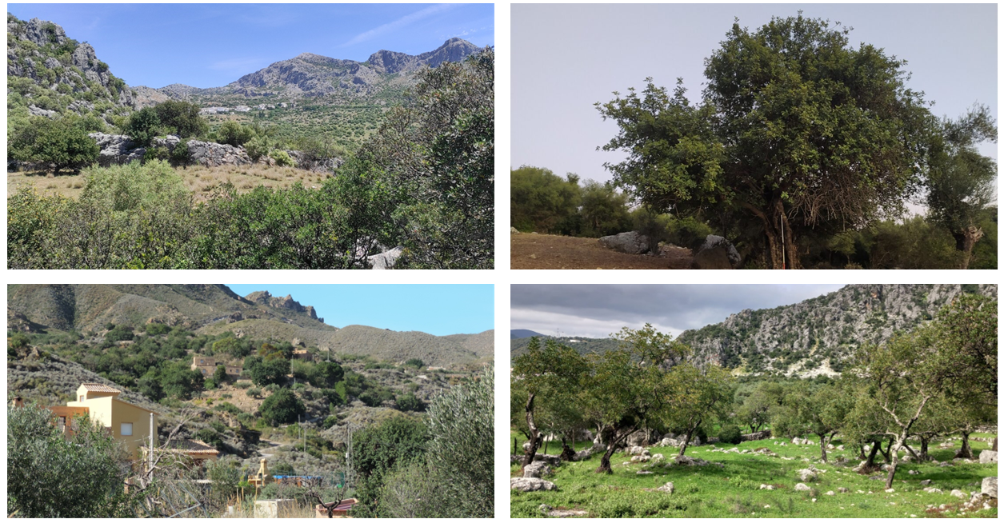
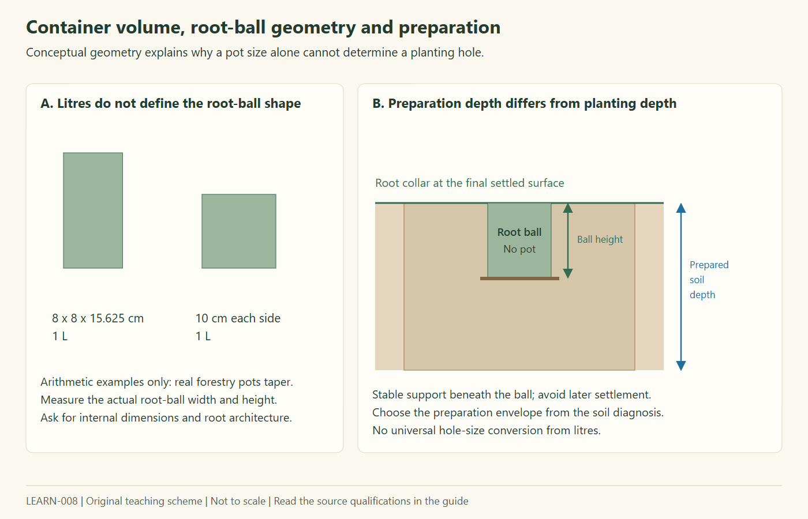
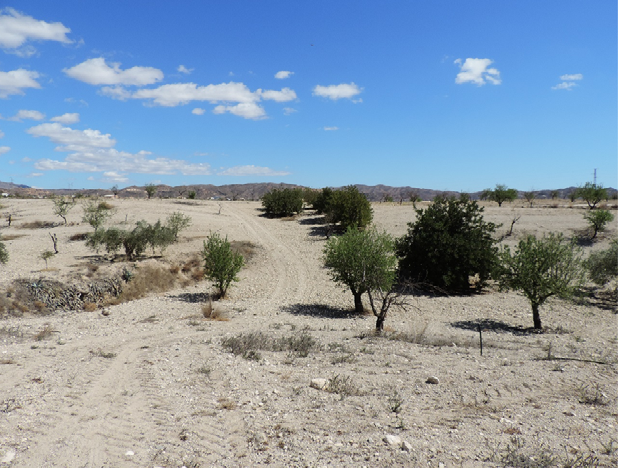
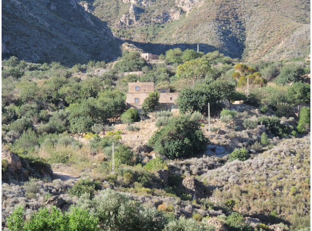
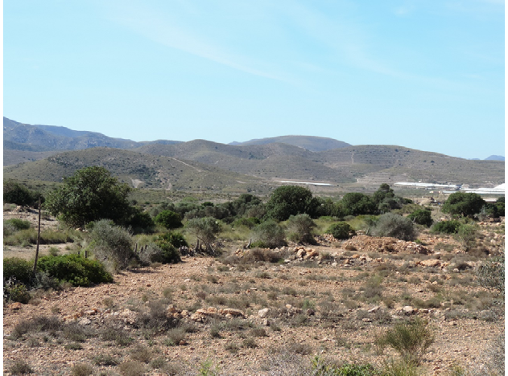
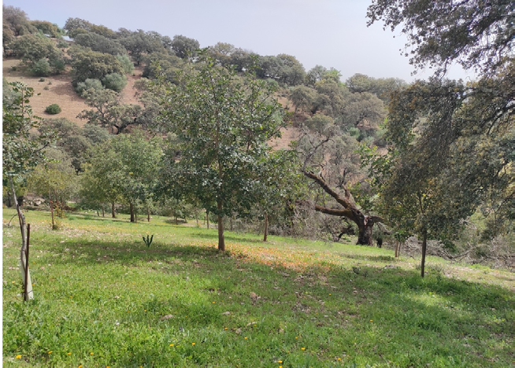
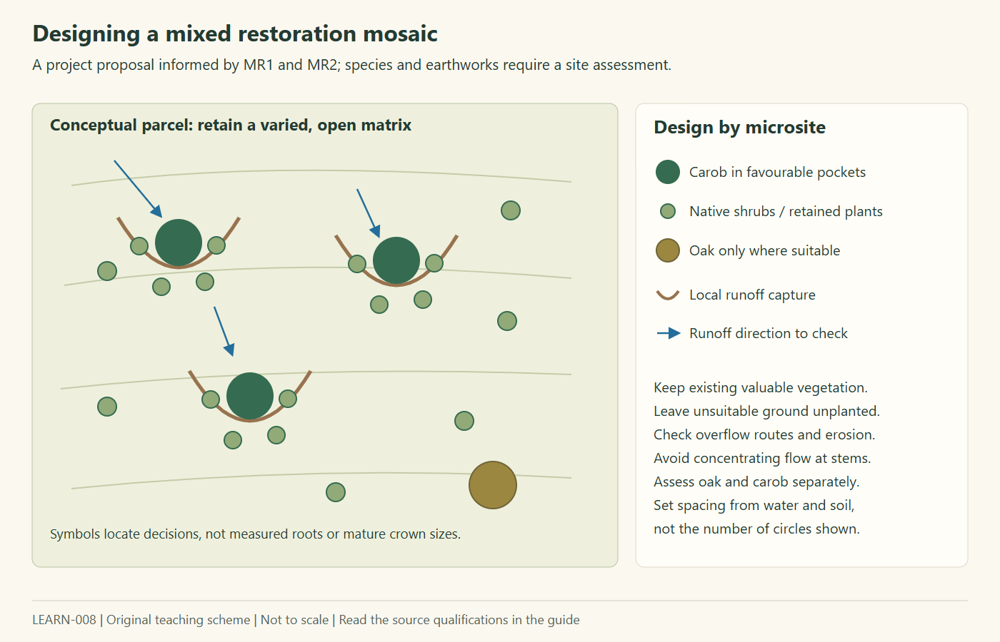

# Carob restoration: nursery buying guide and mixed planting models

Prepared **28 October 2026** for the Algarroba demonstrator. Species: **algarrobo / carob, *Ceratonia siliqua* L.**

**Project objective:** establish seed-grown carob within a diverse native vegetation mosaic, favouring sustained healthy growth with limited external water. Grafting and commercial orchard intensification are outside the proposed planting model.

This is a structured reading of **chapter 4, particularly section 4.3, and chapter 5** of [FOREST-002: the Andalusian carob handbook][B]. It complements [LEARN-007: soil preparation and limited-water growth][soil], which treats deeper preparation, backfill and drainage in more detail. No application configuration or planting defaults are changed.

Page references below are the handbook's printed pages; these agree with the corresponding PDF page numbers. Finca observations described as current in the book generally relate to its **2023–2024 reporting context**, not a new inspection in October 2026.

## Contents

1. [What fits this project](#1-what-fits-this-project)
2. [Plantation, restoration and the seven models](#2-plantation-restoration-and-the-seven-models)
3. [Buying seed-grown nursery stock](#3-buying-seed-grown-nursery-stock)
4. [Containers and substrates](#4-containers-and-substrates)
5. [Root-ball dimensions and preparation size](#5-root-ball-dimensions-and-preparation-size)
6. [Fertilization: nursery versus field](#6-fertilization-nursery-versus-field)
7. [What micorrizacion means](#7-what-micorrizacion-means)
8. [The most relevant finca examples](#8-the-most-relevant-finca-examples)
9. [Carob, oak and shrubs in one parcel](#9-carob-oak-and-shrubs-in-one-parcel)
10. [Establishment and water planning](#10-establishment-and-water-planning)
11. [A demonstrator proposal](#11-a-demonstrator-proposal)
12. [Funding interpretation](#12-funding-interpretation)
13. [Contradictions and unresolved questions](#13-contradictions-and-unresolved-questions)
14. [Sources, downloads and illustration rights](#14-sources-downloads-and-illustration-rights)
15. [Pending Explorer notes: dryland oaks and vegetation series](#15-pending-explorer-notes-dryland-oaks-and-vegetation-series)

## 1. What fits this project

**The strongest starting point is a mixed restoration planting using MR1 principles, with MR2 rainfall-capture measures where justified by the site.** The book explicitly includes seed-grown carob, native companion species, irregular groups, low overall tree density and selection of favourable soil/moisture pockets. A planted landscape can therefore be a restoration project; planting does not inherently make it a commercial orchard. [B, pp. 97, 123–134]

| Decision | Evidence or implication |
|---|---|
| Seed-grown, ungrafted carob | Explicitly appropriate to forest restoration; obtain known seed provenance and diverse material. [B, pp. 71, 123–125, 133] |
| Carob mixed with shrubs and other trees | Explicitly included in MR1 and MR2. Match the species to the actual habitat, soil and moisture. [B, pp. 123–125, 131–133] |
| Limited external water | MR2 is especially relevant, but the model still allows support watering. Existing dryland trees do not establish a zero-water protocol for new seedlings. [B, pp. 132–137] |
| A carob-and-oak landscape | Supported as a landscape type by the dehesa examples, with substantial climatic qualifications for Almería. [B, pp. 98–105] |
| Fast growth | Improve suitable stock, rooting conditions and water access first; distinguish healthy establishment from maximizing irrigated orchard growth. This ordering is a project synthesis, not a tested ranking of treatments. |
| Fertilizer and inoculation | Potentially useful nursery tools and optional demonstrator comparisons; the book does not establish a universal low-water field dose. [B, pp. 77–79, 125–126, 134] |

**Evidence labels used here:** *book guidance* is a recommendation; *finca observation* describes a real site without a controlled comparison; *external experiment* refers to a separately checked study; *project proposal* is our interpretation. These categories must remain distinct when developing specifications or future simulator inputs.

## 2. Plantation, restoration and the seven models

### 2.1 What the terms mean here

*Plantación* describes establishing plants and is used for both production and restoration. *Forestación* can establish woodland on former agricultural land. *Restauración* concerns recovering ecosystem functions and vegetation. *Renaturalización* emphasizes recovery toward a more natural system. These are ecological descriptions here, not automatic land-use or grant classifications.

A productive planting may have environmental benefits. Conversely, collecting some fruit from a restored landscape does not by itself describe its entire ecological purpose. Funding classification must follow the actual operation, management and economic use, rather than its label. [B, pp. 91–98, 123–140; funding discussion in section 12]

*Figure 1. The complete photographic plate from book Figure 5.1, p. 92. Its caption identifies Cádiz, Málaga and Almería examples but does not name an individual photographer or photograph dates. The images illustrate variation in vegetation structure; they are not measured planting designs. Extracted without retouching or rescaling; see illustration rights in section 14.*

### 2.2 Comparison of the models

| Model | Purpose and management | Relevance to this project |
|---|---|---|
| **MP1: enrichment of dehesas** | Add carob to an existing open oak landscape, often replacing losses while retaining grazing and fruit uses. Generally fewer than 50 introduced carob/ha in the model discussion. | Useful structural inspiration for mixed trees; many management examples later graft the carob. Not a direct dry-Almería prescription. |
| **MP2: improve older afforestations** | Improve productive performance of established plantings through density management, grafting and tree care. | Older seed-grown stands provide useful observations; the proposed conversion to production differs from our objective. |
| **MP3: new extensive orchards** | Establish a low-input fruit crop, with orchard spacing, selected material, establishment water and pruning. | Some preparation practices are informative, but crop-oriented management should not define the restoration model. |
| **MP4: technically intensive orchards** | Selected grafted stock, irrigation, nutrition and mechanized harvesting. | An input-intensive comparison, not the proposed project. |
| **MR1: restore degraded areas** | Seed-grown carob with other forest species, erosion protection and biodiversity functions. | **Direct conceptual match.** |
| **MR2: oasification** | Place planting islands where runoff and sediment can be retained; especially relevant below 300 mm annual rainfall. | **Strongest dryland design reference**, conditional on catchment and soil assessment. |
| **MR3: diversify agricultural landscapes** | Add carob and vegetation mosaics within or around agricultural land; informal production can remain. | Useful if existing olive/almond land is retained, though examples often use grafting. |

Sources: model overview [B, pp. 97–98]; MP1 [pp. 98–106], MP2 [106–113], MP3 [114–118], MP4 [118–123], MR1 [123–130], MR2 [130–137], MR3 [137–142]. These are the book's technical model names, not grant categories.

## 3. Buying seed-grown nursery stock

### 3.1 Propagation: what to request

| Spanish term | Meaning | Buying implication |
|---|---|---|
| **Planta de semilla / brinzal** | A plant raised from a seed; offspring are genetically variable. | Request this for the restoration component, with documented collection origin. |
| **Una savia / 1+0** | One growing season of nursery production in the short-cycle programme. | Age alone does not establish quality. Ask how long it has occupied its current container. |
| **Planta injertada** | A selected shoot or bud joined to a rootstock. | Excluded from this project's proposed stock, even if the rootstock itself came from seed. |
| **Micropropagación in vitro** | Laboratory multiplication of small plant tissues under controlled, sterile conditions; the described application concerns clonal rootstocks. | A different propagation route, not required for buying diverse seed-grown plants. |
| **Portainjerto** | A rootstock intended to receive a graft. | Seed-grown rootstock is not necessarily unsuitable, but confirm it is supplied ungrafted and is functionally suitable for restoration. |

The book distinguishes seed plants for restoration from grafted production material and experimental tissue-culture approaches. Seed origin and propagation method are separate questions: a nursery's location does not establish where its seeds were collected. [B, pp. 67, 70–71, 79–83]

Seed-grown trees will not have a predetermined cultivar performance or guaranteed sex. The older Los Lirios stand reportedly has approximately 50% male trees; this is a site observation, not a forecast for a small batch. Do not budget orchard-like fruit income from the restoration seedlings. [B, p. 113]

### 3.2 Buyer inspection and supplier questions

| Check | Ask or inspect | Reason and evidence |
|---|---|---|
| Identity and origin | Species, seed collection area, batch identity and source documentation; whether seed came from multiple parent trees. | Known origin and genetic diversity matter for restoration. The exact parent-tree collection rule remains to be specified. [B, pp. 70–71, 124–125, 133] |
| Root architecture | Inspect representative plants out of their pots: no coiling, hooked main root, decay or severely damaged roots; adequate fine branching. | Container volume cannot compensate for malformed roots. [B, pp. 75, 80, 84; N, pp. 4–6] |
| Root-ball integrity | Roots and substrate form a coherent plug that can be removed and handled intact; avoid either a collapsing plug or a densely pot-bound mass. | Carob lateral roots are fragile and rooting quality is important. [B, pp. 67, 75; N, p. 5] |
| Shoot balance | A sturdy, healthy shoot proportional to the roots; inspect collar diameter and height together. | The tallest plant is not automatically the best plant for a water-limited site. [B, pp. 79, 84–85] |
| Health | Healthy foliage and collar, no desiccation, mould, necrosis, pest damage or root rot. | Nursery disease can compromise survival and introduce pathogens. [B, pp. 83–85] |
| Hardening | Ask about outdoor acclimation, irrigation conditioning and the expected planting date. | The programme moves stock outdoors and includes preconditioning; a greenhouse-grown shoot is not evidence of field readiness. [B, pp. 72, 78–79] |
| Nutrition | Substrate composition, fertilizer product, application date and remaining release period; any leaf/water analyses. | Nutrient reserves and exhaustion of nursery fertilizer matter. [B, pp. 77–79] |
| Handling | Moist root balls, shade and suitable transport; arrange delivery near the planting window. | Avoid damaged or dried stock and unnecessary holding time. [N, pp. 5–6] |

**Morphology references, not universal acceptance limits:** Table 4.9 gives recommended 1+0 values of **25–35 cm height** and **2.5–4 mm root-collar diameter**. The local Níjar supply specification instead requests a minimum base diameter in the **4–6 mm** range for the stated stock category. The handbook's restoration tables also list much smaller 8–10 cm seedlings. A purchase specification must select and justify a consistent stock class, rather than combine every number. [B, pp. 85, 126, 134; N, pp. 4–5]

Suggested enquiry wording: *Ceratonia siliqua, planta de semilla sin injertar, procedencia conocida y lote trazable, endurecida para plantación otoñal en ambiente semiárido; indicar volumen y dimensiones interiores del envase, edad, altura, diámetro del cuello, sustrato y fertilización. Facilitar inspección de cepellones y raíces.* This is a project draft, not an official procurement standard.

## 4. Containers and substrates

### 4.1 Which container volume?

| Volume | What the sources actually say | Interpretation for buying |
|---|---|---|
| **200–300 cm³ = 0.2–0.3 L** | Conventional short-cycle restoration stock on p. 75; repeated in MR1/MR2 summary tables, pp. 126 and 134. | A documented forestry format, not evidence that it is optimal for every parcel. Inspect quality and available care. |
| **1 L** | The short-cycle nursery programme on p. 72 lists 1 L pots. The Níjar restoration supply specification explicitly orders carob in 1 L forest containers. | A defensible **candidate for a pilot purchase**, supported by a nearby restoration procurement example; not a proven growth optimum. |
| **1–2 L** | Alternative high-functional-quality stock on p. 75, including rootstock production; p. 80 also discusses this range for longer-cycle stock. | Consider if roots, acclimation, cost and establishment care justify it. Greater volume alone is not a quality guarantee. |
| **More than 1 L** | MR2 narrative on p. 133 regards larger stock as preferable, although its summary table returns to 0.2–0.3 L. | A comparison worth resolving with an experienced local nursery; retain the conflict in procurement notes. |
| **More than 2 L and taller than 1 m** | General planting guidance connects this stock class with preparation deeper than 60 cm. [B, p. 95] | Different stock and preparation context; not an instruction to buy large trees for every restoration island. |

**Project proposal:** compare well-formed **1 L seed-grown stock** with a clearly specified smaller or larger alternative only if there are enough comparable plants and an explicit monitoring question. Ask for dimensions and root inspection before deciding. There is no support here for a universal rule that the largest container maximizes growth per litre of water or per euro.

The Níjar document specifies anti-spiralling ribs/channels or equivalent container geometry, air-pruning through elevated production and rejection of root rebound/coiling. These are useful requirements alongside the volume. [N, pp. 4–6]

### 4.2 What substrate is preferable?

The book explicitly says there is **no single ideal substrate**. The choice is tied to container geometry, growing cycle, irrigation, fertilizer and root-ball stability. Its useful buying principles are **sufficient aeration and available water, healthy fine roots, structural stability and appropriate nutrition**. [B, pp. 76–77, 80]

Examples from Table 4.6, p. 76:

| Nursery context | Mixture reported in the book | Qualification |
|---|---|---|
| Short cycle | Sphagnum peat : perlite : vermiculite **3:1:1** | Nursery formulation example, not a planting-hole backfill. |
| Short cycle | Pine bark : Sphagnum peat : pine sawdust **3:1:1** | Another listed option; maturity and physical properties require nursery control. |
| Long cycle | Coconut fibre | Listed as a stable longer-cycle base. |
| Long cycle | Coconut fibre : pine bark : perlite **6:3:1 by volume** | Table example; the later grafted-stock text differs. |
| Longer-cycle grafted stock, p. 80 | Coconut fibre : vermiculite **2:1 by volume** | A separate context; not automatically the seedling specification. |

The p. 76 narrative specifies air volume above **10% at 10 cm water-column suction** and readily available water above **32%**. These are laboratory substrate-property statements, **not percentages of components or field moisture thresholds**. It discusses small mineral-fines additions below 10%, but provides no universal buyer recipe.

The same page gives inconsistent organic-component ranges, while p. 80 discourages materials appearing in Table 4.6. Therefore request the nursery's actual formulation and measured performance instead of declaring one blend optimal. The Níjar specification provides a local comparison: porous peat-based media, moist but not compacted, with a coherent root ball. [B, pp. 76–80; N, pp. 5–6]

**Keep nursery substrate separate from field backfill.** A small engineered potting medium does not justify replacing a large planting pit with peat, coir, sand or compost. The soil interfaces, settlement and drainage questions are treated in [LEARN-007][soil].

## 5. Root-ball dimensions and preparation size

### 5.1 There is no verified litres-to-hole table

The handbook does **not** provide a validated rule such as “1 L plant requires a 40 cm hole; 2 L requires a 60 cm hole.” It reports preparation dimensions for specific methods and sites. Container volume does not uniquely identify root-ball width or height.

*Figure 2. Original geometric explanation. The rectangular 1 L examples are arithmetic, not commercial pot specifications. The root collar remains at the intended final surface while preparation can extend deeper; stable support is needed beneath the ball. Root-collar placement and settlement principles are discussed in [LEARN-007][soil]; the carob preparation examples are listed below. No hole multiplier is prescribed.*

| Reported operation | Dimensions / depth | Context and limits |
|---|---|---|
| Huerta Los Tamayos | **40 × 40 × 40 cm** manually prepared holes; approximately **20 cm effective installation depth** | Forestry stock 40–50 cm tall; wetter Cádiz dehesa/olive enrichment. [B, pp. 102–104] |
| Los Lirios | Subsoiling to **50 cm**, then **30 × 30 × 30 cm** planting holes; approximately **20 cm effective installation depth** | Demonstrates that planting-hole dimensions and overall preparation depth are different. [B, p. 111] |
| El Triguero | Cross-subsoiling, then **30 × 30 × 30 cm** holes | 1 m-tall plants in a productive planting; container dimensions are not provided. [B, p. 117] |
| Las Labores, Albox | **40 × 40 × 40 cm** manual holes | 1 m-tall plants, with summer drip irrigation; not proof of an optimum for 1 L stock. [B, p. 127] |
| MR2 oasification guidance | **60 × 60 × 60 cm** holes, a microcatchment and stone mulch | A model recommendation, not a comparative depth trial or instruction to bury the root collar 60 cm down. [B, p. 134] |
| General large-stock recommendation | Preparation **deeper than 60 cm** | Specifically mentions plants taller than 1 m in containers larger than 2 L. [B, p. 95] |
| Buenavista intensive orchard | **1 × 1 × 1 m**, backfill mixed 50% with cured cow manure | An irrigated production example, not adopted as the restoration backfill design. [B, pp. 122–123] |

### 5.2 How to choose for the actual parcel

**Project decision sequence:** measure the supplied root ball; inspect soil depth, restriction and drainage; choose the surrounding preparation envelope; position the plant without burying its collar; account for settlement and rainfall overflow. This is a synthesis, not a verbatim handbook procedure.

Deeper preparation can help where it opens connected, rootable soil. A deeper isolated pocket over impermeable rock is a different intervention. The appropriate depth, width, machinery and backfill remain **site decisions**, not values inferred from nominal pot litres. See [LEARN-007][soil] for diagnostic sections and backfill-interface schemes.

## 6. Fertilization: nursery versus field

### 6.1 What the nursery chapter supports

Carob can respond strongly to nutrition in nursery culture. The chapter discusses declining growth when controlled-release reserves are exhausted, the importance of phosphorus for root development, and available iron where alkaline irrigation water raises substrate pH. It does not provide one programme valid for every nursery. [B, pp. 77–79]

| Nursery example reported | Dose or sequence | How to read it |
|---|---|---|
| Controlled-release formulation **16-8-9** | **3.5 g product/L substrate** | Substrate-incorporation example; not 3.5 g elemental N/L and not a field irrigation concentration. |
| Controlled-release formulation **9-13-18** | **5 g product/L substrate** | Alternative formulation; **not an additional simultaneous dose**. |
| Fertigation sequence | **12-6-6**, then **20-15-5** with iron chelate, then **10-7-9** | Formulations alone do not specify the required dilution, delivered volume or frequency. Not a complete operational recipe. |
| Experimental nutrient concentrations | **150 mg N/L**, with P increased from **10 to 70 mg/L**, in a 300 cm³ ForestPot context | A reported nursery treatment response; not a transferable field-per-tree recommendation. |

Source: [B, p. 77]. The N-P-K designations are reproduced as printed; confirm the supplier's nutrient declaration, release period and applicable product instructions before use.

For illustration, the first rate corresponds to **3.5 g product in 1 L of nursery medium**, or 0.875 g in 0.25 L. That arithmetic **does not authorize adding the same concentration throughout a 216 L field pit**. Nursery roots, medium, irrigation and salt exposure are a different system.

### 6.2 What changes after planting

| Context in the book | Fertilization position |
|---|---|
| MP1 dehesa enrichment | Narrative says no fertilization once established; Table 5.2 allows fertilization at implantation. [pp. 101–103] |
| MP2 established afforestation | Table 5.7 says no fertilization. [p. 109] |
| MP3 extensive production | Allows basal organic matter, P and K; Table 5.10 places fertilization at establishment. [pp. 115–116] |
| MP4 intensive production | Fertilization/fertigation is part of the production system. [pp. 119–123] |
| MR1 and MR2 restoration | No routine fertilization in their summaries; protective planting narrative also generally omits it. [pp. 125–126, 134] |

**Project proposal:** buy appropriately nourished stock first. If investigating field fertilizer for faster growth, identify a soil/plant deficiency, select a justified product and dose with a competent local adviser, and compare it with an untreated group under the same water rules. Record survival, collar growth, shoot growth, symptoms, cost and water. The book supplies **no validated low-water field dose** for our parcel. Extra nutrients cannot be assumed to compensate for unavailable water.

## 7. What micorrizacion means

**Micorrización** is the establishment of a mycorrhizal association between plant roots and suitable fungi. The fungal network can improve access to nutrients and influence water-stress response; the plant supports the association with carbon. It is different from fertilizer and different from nitrogen-fixing root nodules.

The carob chapter emphasizes **arbuscular mycorrhizal fungi (AMF)** and also discusses other fungal inoculation work. “Mycorrhizal” is not a single interchangeable product category. Ask which fungi are used, why they suit carob, how inoculation was done, and whether root colonization was checked. [B, p. 78]

An external check of the cited **Jadrane et al. (2021)** study supports potential benefits: a selected indigenous AMF mixture improved seedling growth and drought-response measures in a **greenhouse pot experiment** with imposed moisture treatments. It does not establish a universal field survival gain, inoculum dose or minimum irrigation volume for Almería. [M]

**Important source problem:** p. 78 moves from AMF to a carpophore/truffle suspension procedure. That passage should not be interpreted as a validated generic carob-AMF recipe. Keep inoculant identity, compatibility and evidence separate; do not infer that arbitrary mushroom material will work.

**Project proposal:** treat verified nursery mycorrhization as an optional stock attribute or a small controlled comparison, rather than a mandatory purchase surcharge. Ask for the inoculation and colonization evidence. Existing naturalized fincas demonstrate ecological outcomes, not proof that purchased inoculants are necessary.

## 8. The most relevant finca examples

### 8.1 Comparison at a glance

The following climate ranges are **the handbook's reported site characterizations**, mostly from mapped climate information, not newly measured station records. “Minimum of the coldest month” in its tables is not an absolute frost minimum. Photos alone cannot establish rainfall or soil depth.

| Finca and pages | Annual rain | Management and vegetation | Transfer to our project |
|---|---:|---|---|
| **Las Labores, Albox, Almería**, 126–128 | **200–400 mm** | Declining olive/almond land converted toward carob; shallow calcareous soils; summer irrigation and later grafting. | Strong site-management comparison, partial ecological/management match. |
| **La Alcantarilla, Mojácar, Almería**, 134–136 | **200–300 mm** | Seminatural carob around houses and a stream; lentisk and wild olive establish with it; limited later care. | Strong vegetation-structure and runoff-location reference. |
| **La Tórtola, Níjar, Almería**, 136–137 | **200–300 mm** | Naturalized carob associated with former farming/grazing; lentisk and wild olive; no cultural treatments reported. | Strong reference ecosystem; not a documented seedling-establishment trial. |
| **El Triguero, Carmona, Sevilla**, 117–118 | **400–600 mm** | Former cereal land, soil less than 50 cm deep; orchard conversion, cross-subsoiling and emergency watering. | Preparation example, but the dry-looking photograph is not a 200–300 mm climate analogue. |
| **Huerta Los Tamayos, Prado del Rey, Cádiz**, 102–104 | **800–1,200 mm** | Carob among olives and in sparse holm-oak dehesa; grazing and grafting. | Useful mixed-landscape inspiration; substantially wetter. |
| **Los Lirios, Gaucín, Málaga**, 109–113 | **800–1,200 mm** | Older afforestation, partly mixed with oaks; original seed-grown stand with no establishment irrigation reported. | Demonstrates established seed-grown trees; wetter climate and separate intensive mother-stock area must be distinguished. |
| **Rozas Altas, Gaucín, Málaga**, 140–142 | **800–1,200 mm** | Irregular carob enrichment among olives/almonds; seed-grown stock, subsequently grafted; no support irrigation reported. | A mosaic-management example, not proof that our much drier site needs no watering. |
| **Buenavista, Posadas, Córdoba**, 121–123 | **600–800 mm** | Intensive orchard conversion with large amended pits, repeated summer watering and grafting. | Useful input comparison; poor fit to limited-water ecological restoration. |

### 8.2 Las Labores: useful, but not a zero-water restoration recipe

*Figure 3. Left photograph of book Figure 5.37, p. 128, Las Labores, Albox. Credit: QUERAT (2024). Its open cultivated ground should not be mistaken for evidence of a mixed shrub restoration design.*

The book describes carob introduced in **2010** into areas where almond trees had died, at **6 × 6 m**, using approximately **1 m-tall nursery plants** and manually prepared **40 cm cubes**. The site has low-fertility, shallow soils with rocky outcrops. [B, pp. 126–127]

Reported management includes **60 cm perforated protectors**, summer drip irrigation from May to September totalling **400 L per tree** for that reported seasonal period, tillage approximately every three years, staking, formation pruning and grafting. The book does not supply a complete event-by-event irrigation schedule or establish when watering stops. [B, p. 127]

For scale only, a full **6 × 6 m grid is about 278 trees/ha**; at 400 L/tree, that would be approximately **111 m³/ha per summer period**. These are calculated illustrations, not measured whole-finca use: the described planting occupied selected gaps, and planted area, actual counts and irrigation coverage are not fully specified.

The reported trees are **3–5 m tall**, with low mortality described but not numerically quantified. This is a useful observational success case, **not a comparison isolating pit size, fertilizer or irrigation effects**. Its classification as MR1 does not make all of its management identical to an ungrafted, mixed-native restoration project. [B, p. 128]

The chronology is inconsistent: p. 127 says grafting in autumn 2024; p. 128 describes production four years after grafting and a 2023 fruit sample. Do not reconstruct growth-to-production timings from those statements without author clarification.

### 8.3 La Alcantarilla: carob facilitating a shrub-associated system

*Figure 4. Book Figure 5.49, p. 135. Credit: QUERAT (2024). A real landscape reference, not a measured microcatchment cross-section.*

At **200–300 mm annual rainfall**, the carob population occurs around country houses, a stream, roads and irrigation channels. Under carob cover, **lentisk and wild olive** have begun establishing. Planting and natural expansion have created a more complex vegetation pattern. Later care is described as limited beyond fruit collection; production is variable and often small or absent. [B, pp. 134–136]

**Why it matters:** it illustrates the desired combination of carob, shrubs and favourable water redistribution. It does **not** provide original container size, hole dimensions, establishment survival statistics or a verified zero-irrigation history. Nor does a semi-natural streamside example authorize constructing works in a watercourse.

### 8.4 La Tórtola: a naturalized reference in Níjar

*Figure 5. Book Figure 5.52, p. 137. Credit: QUERAT (2024).*

This **200–300 mm rainfall** example is associated with former agricultural and grazing activities. Abandonment allowed typical vegetation, including **lentisk and wild olive**, to establish. The book calls it naturalized and reports no cultural treatments. Tree heights range from **1 to 10 m**, reflecting an irregular population; fruit production is very irregular and practically absent in the described setting. [B, pp. 136–137]

**Why it matters:** perhaps the clearest local picture of the proposed ecological direction. It demonstrates a possible established vegetation structure, rather than how many years, how much initial water or which bought stock will reproduce it on a new parcel. Its existing development must not be converted into a predicted growth curve.

### 8.5 Additional lessons from the other fincas

**Los Lirios:** the original stand was planted with seed-grown 30–50 cm plants, autumn installation, subsoiling and small planting holes. No establishment irrigation or fertilizer was reported for that stand. A later, separate mother-stock plot receives **50 L/tree per watering, three times weekly from April to October**. Mixing those two histories would give a false account of either system. [B, pp. 111–113]

**Huerta Los Tamayos:** mixed olive/carob and oak/carob layouts have persisted for decades. The reported establishment included **three summer waterings of 50–80 L/tree during the first two years**, protectors, hay mulch and later grafting. Its wetter climate prevents direct transfer of that watering schedule. [B, pp. 102–104]

**Buenavista:** 1 m³ pits with 50% cured manure backfill were accompanied by **100 L/tree every 15 days during the first two summers**. That is an orchard practice package, not evidence that deep manure-rich holes produce fast growth with little water. [B, pp. 122–123]

## 9. Carob, oak and shrubs in one parcel

*Figure 6. Book Figure 5.6, p. 100: mixed holm-oak dehesa with carob. Credit: QUERAT (2024). This photograph is not identified as an Almería climate analogue.*

### 9.1 The landscape idea is supported

MP1 explicitly enriches oak dehesas with carob; MR1 names **holm oak (*Quercus ilex*)**, wild olive and lentisk among restoration companions. MR2 focuses on drier systems with wild olive, palmito, lentisk and xerophytic shrubs, and sometimes other tree species. [B, pp. 98–100, 123–125, 131–133]

The book therefore supports a **mixed vegetation concept**. It does not establish that the same oak species or density is suitable throughout a very dry Almería finca. Existing valuable shrubland or open habitat also needs a restoration objective of its own, rather than being treated as empty ground awaiting trees.

### 9.2 A proposed spatial arrangement

*Figure 7. Original project proposal informed by MR1/MR2. The symbols do not prescribe mature canopy sizes, catchment area, spacing or plant count. Earthworks require soil, runoff and overflow assessment.*

| Microsite | Proposed role | What needs verification |
|---|---|---|
| Deeper soil with beneficial run-on | Carob-focused planting island, with compatible shrubs and retained vegetation. | Soil depth, infiltration, seasonal water availability and safe overflow. |
| More sheltered or moist pocket | Consider a small oak component if ecologically suitable. | Oak taxon/provenance, actual frost exposure, effective soil volume and a defensible establishment-water budget. |
| Drier surrounding matrix | Native shrubs, grasses and existing vegetation; potentially no new planting. | Local reference community and conservation value. |
| Active drainage line | Retain its function; consider only appropriately assessed interventions. | Flood forces, sediment, permissions and effects upstream/downstream. |

Do not mechanically copy the entire book's companion list. For example, the occurrence of figs, pines, cork oak or wetter Mediterranean shrubs in a particular model does not automatically make them restoration targets for our parcel.

### 9.3 Density: keep the area denominator explicit

MR2 discusses low overall tree densities, **below 100 trees/ha**, sometimes around **50/ha**, but also closer spacings within individual favourable groups. A **6 × 6 m grid over an entire hectare would be about 278 trees/ha**, not fewer than 100. A grouped planting can have tighter internal spacing while retaining a much lower parcel-wide density. [B, pp. 132–134; arithmetic interpretation]

For the illustrative **4,500 m² parcel** and **200 m² demonstration area** discussed in this project, multiplying a broad-hectare density directly by the small planted patch would be misleading. Count trees, shrub cover, donor catchment area and long-term rooting space separately. This report does not prescribe a plant count for either area.

## 10. Establishment and water planning

Section 5.3 describes **3–5 years of establishment care**. It favours autumn/winter planting with suitable soil moisture and avoidance of severe frost, and mentions **1–5 summer waterings during the first five years** without providing a universal per-event volume. MR2 narrows the planting window toward autumn/early winter, but the actual site still needs frost and rainfall assessment. [B, pp. 95–96, 133–134]

| Stage | Planning action | Evidence status |
|---|---|---|
| Before purchase | Inspect soil and vegetation; select stock suited to the site and objective; budget follow-up care. | Book guidance and project synthesis. |
| Before delivery | Prepare appropriate planting sites and runoff/overflow design; confirm a favourable planting window. | Book guidance, with site-specific dimensions unresolved. |
| Planting | Preserve the root ball, set the intended collar level, provide stable support, and record stock and treatment. | Installation synthesis; geometry explained in section 5. |
| First spring/summer | Check moisture, competing vegetation immediately around seedlings, browsing, protector condition and symptoms. Record all water delivered. | Book guidance; monitoring protocol proposed. |
| Years 1–5 | Review survival and growth, replace failures where justified, maintain protection and only the care the site needs. | Book establishment horizon; no fixed annual irrigation allocation established. |

The general MR1 table says **no irrigation**, MR2 says **support irrigation**, and Las Labores receives seasonal drip water. These are different situations. No minimum/optimum litres per week, universal stopping date or zero-water guarantee can be extracted for our seedlings. Irrigation decisions should remain conditional and measured, with an agreed rescue rule and cumulative water budget.

## 11. A demonstrator proposal

**Purpose proposed for discussion:** demonstrate whether well-sourced seed-grown carob and native companion vegetation can establish a diverse, resilient patch using suitable microsites and a bounded external-water input.

| Priority | Proposed work | Useful output |
|---|---|---|
| 1 | Record existing vegetation, slope/runoff, soil profiles, rock restrictions, exposure and water access. | A microsite map, including places to leave undisturbed. |
| 2 | Choose an MR1/MR2-informed layout; retain suitable shrubs and open ground. | A mixed planting design with tree groups, companion matrix, catchment areas and overflow routes. |
| 3 | Obtain traceable, ungrafted seedlings; compare nursery offers against one coherent quality specification. | A buying sheet covering provenance, dimensions, roots, medium, nutrition and price. |
| 4 | Select one principal uncertainty to compare, such as stock class or justified runoff capture. | A small interpretable comparison with comparable sites; do not change every factor simultaneously. |
| 5 | Use consistent establishment and rescue-water rules; record failures and causes. | Survival, collar growth, height, symptoms, cumulative litres, labour and costs. |
| 6 | Add an oak component only after suitability is established; consider fertilizer/mycorrhiza separately. | Optional additions with their own evidence and questions. |
| 7 | Share the methods and results if pursuing a demonstration grant. | A transferable public learning output, rather than simply a planting invoice. |

This is a design proposal, not an adequately powered experiment or a funding application. The number of plants, comparison layout, water thresholds and observation period remain to be agreed after the site assessment. Healthy growth and survival per unit of external water are more useful outcomes here than a promise of the fastest possible orchard growth.

## 12. Funding interpretation

**Ecological and financial classifications are separate.** A mixed planting needs a defensible habitat objective; adding shrubs does not alone establish grant eligibility.

Under the checked **3 February 2026 LEADER rules**, **3.4** concerns nonproductive demonstration, excludes final objectives of improving productive-sector competitiveness, requires open access and dissemination, and specifies eligible beneficiary types. **3.5** concerns rural/environmental heritage conservation and recovery, with its own nonproductive-use and public-access conditions. Neither is blanket financing for a private fruit orchard. [G, Annex I, 3.4–3.5]

**Project implication:** compare a genuine restoration-learning operation with direct conservation work, then confirm the correct category, beneficiary, land rights, eligible costs and economic use with the GDR. Approval is not established here.

**AL20 is territorial**, not a programme for all Almería. Its official municipality list excludes Albox, Mojácar and Níjar. These fincas are ecological references, not evidence that their parcels could receive AL20 funding. Check the demonstrator's municipality against the official list. [T]

## 13. Contradictions and unresolved questions

| Issue | Conflicting or incomplete evidence | How this guide handles it |
|---|---|---|
| Container class | p. 72 lists 1 L; p. 75 describes 0.2–0.3 L and 1–2 L alternatives; p. 133 favours above 1 L while Table 5.19 lists 0.2–0.3 L. | Present distinct contexts; no universal optimal litre value assigned. |
| Seedling height | p. 79 discourages stock below 15 cm; p. 85 recommends 25–35 cm for 1+0; MR tables list 8–10 cm. | Do not treat the smallest table value as a purchase default. |
| Stock balance and nutrition | Ratio statements and leaf nutrient references vary between narrative and Table 4.9. | No single shoot:root or foliar target copied as a mandatory procurement threshold. |
| Substrate recipes | General and carob-specific organic fractions differ on p. 76; Table 4.6 and p. 80 differ over long-cycle ingredients. | Compare actual physical properties and nursery performance; no universal blend asserted. |
| Micorrhization | AMF discussion is followed by a carpophore/truffle procedure on p. 78. | Explain the distinction; no generic inoculum recipe adopted. |
| Machinery | p. 95 says preparation should always be mechanized; several actual cases use manual holes, and MR2 allows manual preparation. | Choose by soil diagnosis, access, scale and impact; no blanket machinery requirement adopted. |
| Irrigation | MR1 table says none; MR2 says support; Albox uses 400 L/tree during the reported summer period. | Preserve model/site differences; no minimum/optimum watering schedule invented. |
| Albox chronology | Autumn 2024 grafting, a four-year post-graft statement and a 2023 fruit sample do not form a consistent chronology. | No growth-to-fruiting timeline inferred. |
| Rainfall at El Rano | Narrative p. 129 says 800–1,200 mm; Table 5.17 says 1,200–1,600 mm. | Treat it as a wetter reference, not a precise climate match. |
| Rainfall limit in MR3 | p. 138 says avoid rainfall above 300 mm, whereas its examples are much wetter. | Flag a likely editorial problem; do not silently reverse the inequality. |
| Density versus spacing | Low whole-site densities appear alongside tighter local spacings; some model numbers differ among narrative and tables. | State area basis and whether spacing applies inside groups; retain original context. |
| Date of finca state | A 2026 publication describes many 2023–2024 observations and some future intentions. | Report observations as recorded, not as verified October 2026 outcomes. |
| Provenance and regulation | The handbook refers to existing forestry rules and species coverage. | Use origin/quality principles; do not infer current legal applicability or species listing without a separate check. |

Still unresolved for the parcel: suitable oak taxon and provenance; optimal container class; effective rootable depth; the benefit of deeper preparation; a justified backfill amendment; establishment and rescue-water thresholds; field fertilizer product/dose; effective and compatible inoculum; and appropriate final tree/shrub density. These remain visible decisions, not simulator defaults.

## 14. Sources, downloads and illustration rights

### 14.1 Sources already in the repository

**[B] Primary source.** Navarro Cerrillo, R. M., and Palacios Rodríguez, G. (eds.), **2026**, *Soluciones innovadoras para consolidar el algarrobo como cultivo de alto valor en Andalucía*. UCOPress / Universidad de Córdoba; 168 pp.; eISBN 9788499279497; DOI **10.21071/000069**. [Local FOREST-002 PDF][B]. Chapter 4 authors: R. M. Navarro Cerrillo, A. Á. García Mayoral, G. Palacios Rodríguez, F. J. Ruiz Gómez, R. J. Cabrera Puerto and M. A. El Chami. Chapter 5 authors: R. M. Navarro Cerrillo, G. Palacios Rodríguez, M. A. Lara Gómez, I. Clavero Rumbaó, A. Á. García Mayoral, J. Ortega Ropero and M. A. El Chami. Focused reading: pp. 67–85 and 91–142, including the cited tables and figure captions.

Publisher [publication page][publisher] and [direct book PDF download][bookdownload]. **Already stored as FOREST-002; not a new library addition.**

**[N] Local supply specification.** TRAGSA, *Suministro de planta autóctona para ejecución de obra ecosistemas fluviales en el T.M. de Níjar (Almería)*, **TSA0078436**, [NIJAR-003][N], 8 pp.; publication date not established here. Reviewed pp. 1 and 4–6 for the 1 L carob order, root quality, container design, substrate and delivery criteria. This is a procurement requirement for its particular restoration works, not a comparative container-size trial.

**[soil] Companion synthesis.** [LEARN-007][soil], 28 October 2026. Used for the distinction between preparation and planting depth, settlement/backfill questions and site-diagnostic diagrams. It contains its own underlying source register and limitations.

**Local funding context:** [FUND-005: selected AL20 activities and budgets][F]. Its 3.4 and 3.5 rows were visually inspected. It is not a substitute for the complete current rules or an approval decision.

### 14.2 External checks and documents offered for addition

**[G] Junta de Andalucía, Order of 3 February 2026.** LEADER regulatory bases; BOJA 29, 12 February 2026. [Official text][G]; [direct official PDF download, 163 pages][grantdownload]. **Not added to the library by this task.** Relevant: Annex I, 3.4–3.5. Text and PDF download verified 28 October 2026; a temporary research copy is not a library addition.

**[T] Junta de Andalucía, AL20 territory page.** [Official municipality list and local programme links][T], checked 28 October 2026. Dynamic webpage, not a downloaded library document. No parcel location or funding entitlement was inferred.

**[M] Jadrane, I., Al Feddy, M. N., Dounas, H., Kouisni, L., Aziz, F., and Ouahmane, L.**, **2021**, *Inoculation with selected indigenous mycorrhizal complex improves Ceratonia siliqua's growth and response to drought stress*. *Saudi Journal of Biological Sciences* 28(1):825–832. DOI **10.1016/j.sjbs.2020.11.018**. [Public full-text article page][M]. **Not in the library.** Indexed full-text methods/results were checked to distinguish the greenhouse AMF experiment from a field planting protocol; direct opening sometimes returns a browser challenge. No direct PDF URL was verified for this article, so the link is labelled as a full-text page rather than a confirmed PDF download. Only this limited methodological check supplements the handbook; there was no new systematic literature review.

### 14.3 Figure provenance and reuse

The handbook's p. 6 and publisher page state **Creative Commons Attribution-NonCommercial-ShareAlike 4.0**. Four photographic assets retain their captions' **QUERAT (2024)** credits; the Figure 5.1 plate has no individual photographer/date in its caption and is attributed to the handbook. Each embedded image was decoded to PNG at its original pixel dimensions, with no retouching, sharpening or rescaling. Figure 5.37 is represented by its left-hand photograph only; that selection is explicitly labelled.

The photographic extracts and this adapted research guide are supplied under **CC BY-NC-SA 4.0**, retaining the original authors, publisher, source DOI and figure credits. The two original code-drawn diagrams in the companion folder are also supplied under that licence. This notice applies to these research materials, **not to the repository's application code or unrelated files**. It does not give commercial-use permission for later app incorporation; assess those terms before publishing the extracts in a commercial product.

The diagrams are conceptual geometry, not AI-generated botanical depictions, measurements or growth predictions. [Asset register and editable sources](carob-restoration-guide/README.md) include exact image origins, checksums and rendering details. Source PDF bytes are unchanged.

## 15. Pending Explorer notes: dryland oaks and vegetation series

Recorded **29 October 2026**, at the user's request. These are notes for a later app update; no application content, plant catalogue, defaults or calculations are changed by this section.

### 15.1 Candidate additions and presentation

- Include **coscoja / Kermes oak (*Quercus coccifera*)** as a candidate native companion. The Junta's coscoja factsheet reports natural occurrence around **200 mm annual rainfall at Cabo de Gata**, but a more favourable rainfall range of 400–800 mm. Natural occurrence is not a seedling establishment guarantee or a zero-irrigation protocol. Usually a shrub up to about 2 m; a small tree in favourable conditions, not an assured large shade tree on an arid parcel.
- Retain **encina / carrasca (*Quercus rotundifolia*, also treated as *Q. ilex* subsp. *ballota*)** as a conditional larger-tree candidate for favourable rootable, moisture-retaining pockets. Regional presence does not establish suitability for the driest lowlands. Check local provenance, nearby reference vegetation, soil, exposure and establishment support before proposing a trial.
- A future Explorer explanation should distinguish these two growth forms and their evidence, without automatically selecting plants or assigning survival/watering defaults.
- Retain the earlier SVG idea: explain whole-parcel density versus spacing inside groups, open ground and moisture pockets. This is a future presentation note, not implementation of a saved restoration-model choice.

### 15.2 What the quoted vegetation series mean

A **vegetation series (serie de vegetacion / sigmetum, abbreviated S.)** groups the potential mature reference community and its associated replacement or successional communities under a site's ecological conditions. It is broader than one plant association. It is not a fixed planting mixture, inevitable timetable or instruction to turn all scrub into tall woodland. Interpretation must be checked against actual vegetation and site conditions.

- **Thermo-mesomediterranean, warm, Murcian-Almerian, semi-arid to lower-dry:** describes a warm Mediterranean thermal context, regional distribution and moisture class. The name **Bupleuro gibraltarici-Pistacieto lentisci** identifies a Bupleurum–lentisk series. The coscoja factsheet's Spanish heading calls it a coscoja series, but the Junta's vegetation-management reference identifies the same Latin series as a **lentisk series**. Preserve this source discrepancy; do not infer coscoja dominance from that heading alone. Coscoja can occur in a broader community without being its naming or dominant species.
- **Mesomediterranean, semi-arid Rhamno lycioidis-Querceto cocciferae:** a coscoja series associated with *Rhamnus lycioides* (espino negro), generally in cooler Mediterranean thermal conditions than the thermomediterranean belt. The long regional adjectives refer to biogeographic territories, not different oak varieties. Junta describes an Almerian/Guadix-Baza variant with *Ephedra fragilis*, reaching the Almanzora basin, and associated scrub, retama, esparto and other communities according to substrate and disturbance. They are not all mandatory planting companions.
- **Semi-arid** and **lower-dry** are bioclimatic moisture classes; do not translate them into a universal annual-rainfall suitability cutoff. Nor are the thermal belts fixed altitude bands everywhere.
- Before showing a parcel-specific series in the app, consult the appropriate vegetation mapping, soil and local observations. A lentisk or coscoja scrub mosaic can be a valid restoration reference; a tall oak forest is not the universal destination. No series has been assigned to this project's parcel.

### 15.3 Downloadable references and library status

The two oak factsheets below were downloaded, verified and added on **29 October 2026** as **FOREST-003** and **FOREST-004**. The other external documents remain suggestions for possible library addition. Publication dates are omitted where not verified. The existing carob handbook remains FOREST-002.

- **Junta de Andalucia, Quercus coccifera factsheet, Procedencias de las Especies Vegetales Autoctonas de Andalucia Utilizadas en Restauracion de la Cubierta Vegetal**: [stored locally as FOREST-003](FOREST-003%20-%20Andalusia%20-%20Kermes%20Oak%20Ecology%20and%20Restoration%20Factsheet%20-%20Quercus%20coccifera.pdf); [direct source PDF](https://www.juntadeandalucia.es/medioambiente/BIO/DOC/BIO-DOC-6120-003.pdf). Source of the quoted series list, growth form and Cabo de Gata rainfall observation.
- **Junta de Andalucia, Jardin Botanico Umbria de la Virgen, Encina (*Quercus rotundifolia*), January 2025**: [stored locally as FOREST-004](FOREST-004%20-%20Almeria%20-%20Holm%20Oak%20Botanical%20Factsheet%20-%20Quercus%20rotundifolia%20-%202025-01.pdf); [direct source PDF](https://www.juntadeandalucia.es/medioambiente/portal/documents/20151/255221248/UMBRIA-ENE-2025.pdf/638e27d7-29a8-8718-0c4f-9ac034bbb20d?t=1745493497879). Regional distribution and increasing scarcity in southeastern lowlands.
- **Junta de Andalucia, Datos botanicos aplicados a la Gestion del Medio Natural Andaluz III: Modelos de gestion de la vegetacion, management-model excerpt**, printed pp. 23–42: [direct PDF](https://www.juntadeandalucia.es/medioambiente/consolidado/publicacionesdigitales/40-762_ANEXO_CARTOGRAFICO_Y_SERIES_DE_VEGETACION-MODELOS_DE_RESTAURACION_FORESTAL/40-762/8_MODELOS_DE_GESTION_DE_LA_VEGETACION-03.PDF). Identifies Bupleuro–Pistacieto as a lentisk series, including on printed pp. 29 and 42.
- **Same Junta volume, vegetation-series excerpt**, printed pp. 196–210, especially p. 200: [direct PDF](https://www.juntadeandalucia.es/medioambiente/consolidado/publicacionesdigitales/40-762_ANEXO_CARTOGRAFICO_Y_SERIES_DE_VEGETACION-MODELOS_DE_RESTAURACION_FORESTAL/40-762/26_SERIES_DE_VEGETACION_CLIMATOFILAS_Y_EDAFOXEROFILAS-09.PDF). Describes Rhamno–Querceto, its vegetation stages, soils and local variants.
- **MITECO-hosted Mar Menor restoration document, section 3.7, Estudio y definicion de la vegetacion potencial en las zonas del proyecto**, Jose Lopez Bernal, Eugenia Belen Miras Perez and Antonio Felix Carrillo Lopez (LATIZAL): [PDF download link](https://www.miteco.gob.es/content/dam/miteco/es/biodiversidad/publicaciones/restauracion/MAP.marmenor.restauracion.pdf). Indexed section 3.7.1 supplies the series definition. Full opening exceeded the browser tool's document-size limit; the complete document was not reviewed.

[B]: FOREST-002%20-%20Andalusia%20-%20Carob%20Cultivation%20and%20Restoration%20Handbook%20-%202026.pdf
[N]: NIJAR-003%20-%20Campo%20de%20Nijar%20-%20Native%20Plant%20Supply%20Technical%20Specification%20-%20TSA0078436.pdf
[F]: FUND-005%20-%20Alpujarra%20Sierra%20Nevada%20Almeriense%20-%20LEADER%20AL20%20Eligible%20Activities%20and%20Budgets%20-%202026.pdf
[soil]: LEARN-007%20-%20Carob%20Establishment%20-%20Soil%20Preparation%20and%20Growth%20with%20Limited%20Water.md
[publisher]: https://www.uco.es/servicios/ucopress/omp/index.php/ucopress/catalog/book/69
[bookdownload]: https://www.uco.es/servicios/ucopress/omp/index.php/ucopress/catalog/download/69/83/1938?inline=1
[G]: https://www.juntadeandalucia.es/boja/2026/29/1
[grantdownload]: https://www.juntadeandalucia.es/eboja/2026/29/BOJA26-029-00163-1654-01_00332877.pdf
[T]: https://www.juntadeandalucia.es/organismos/agriculturapescaaguaydesarrollorural/areas/desarrollo-rural/tramitacion-ayudas-dr-2023-2027/paginas/ayudas-leader-intervencion-7119-2-promotores-al-al20.html
[M]: https://pmc.ncbi.nlm.nih.gov/articles/PMC7783803/
