# Irrigation technology for an Almeria restoration demonstrator

Research date: **3 November 2026**. Scope: establishment of native trees, shrubs and vegetation islands, with a possible educational park and later dispersed-area expansion. Original research synthesis and engineering concepts prepared for Algarrobos. Market capabilities are distinguished from independent evidence and proposed experiments. Product availability, prices and exact configurations require quotations before procurement.

**Recommendation:** build irrigation into the demonstrator as a modular, measurable establishment service. Begin with refillable tanks supplying small hydraulic zones, serviceable solar equipment, local control and representative soil measurements. Compare fully electronic per-plant control with simpler sector drip and passive per-plant control on a small subset. Expand the extra electronics only where they improve survival, delivered-water efficiency or operator workload enough to justify their lifetime cost.

The ingredients already exist. A defensible innovation opportunity is their adaptation to low-density native planting: temporary and movable infrastructure, repairability, transparent water accounting, local assembly and a tested transition towards irrigation independence. A sensor, solar panel or LoRa radio by itself is not a new invention.

## Reading routes and visual index

For drone monitoring, soil-moisture mapping and water delivery, read section 13. For the practical irrigation decision, read sections 1, 3, 5, 8 and 10. For technology development, add sections 4, 6 and 7. For a proposal, use sections 9–12 and the [source register and download list](irrigation-research/SOURCES.md).

The first 12 drawings below are original, code-drawn concepts; section 13 adds eight drone figures and twelve sourced reference pictures. Each has a PNG for Markdown and an editable SVG in [the figure directory](irrigation-research/figures/). They show proposed arrangements, not a surveyed site, measured root system, validated circuit, bill of quantities or construction instruction. [Reproduction script](irrigation-research/build_diagrams.py).

| Figure | What it helps decide |
|---|---|
| 1 | Sector, electronic individual and passive individual control |
| 2 | Several tank service areas and dispersed vegetation islands |
| 3 | Hydraulic equipment and delivery verification |
| 4 | Whether gravity is sufficient |
| 5 | Repairable sensor and valve node architecture |
| 6 | What a root-zone probe does and does not observe |
| 7 | Battery-free per-plant moisture control |
| 8 | Wireless communication, local operation and optional cloud |
| 9 | Control states and visible failure handling |
| 10 | Separate water-storage and energy calculations |
| 11 | Local assembly, repairs and component reuse |
| 12 | A replicated comparison trial |

## 1. What is commonly done

### Different settings have different objectives

In horticulture, irrigation generally supplies a production target through drip networks, a central irrigation head and controlled sectors. Greenhouse systems can add nutrient dosing, electrical conductivity (EC), pH and drainage monitoring. Native restoration has a different objective: establish viable plants with a finite support-water budget and determine when support can be reduced. Crop-yield optimisation and permanently moist substrate are unsuitable default objectives for the restoration park.

Common approaches worth considering are:

| Approach | Useful setting | Main limitation for dispersed restoration |
|---|---|---|
| Operator visits with measured hose/tanker watering | Very small pilots, widely separated plants, temporary rescue | Travel and staff time; inconsistent delivery unless logged |
| Surface drip, grouped by irrigation need | Connected islands, park beds, young trees within practical pipe runs | Pipe exposure and leaks; unequal soil or plant conditions inside one sector |
| Weather-adjusted sector control | Larger managed landscapes and established irrigation networks | Weather estimates alone do not establish the condition of a new nursery plug |
| Soil-sensor-triggered sector drip | Similar plants and soils grouped together | Representative sensor placement and calibration are critical |
| Individual electronic valves | Research plots, high-value plants, unusually heterogeneous microsites | Many valves, connections, batteries or cables to inspect |
| Individual passive moisture control | Small gravity-fed clusters and accessible demonstration beds | Commissioning, pressure and cleanliness; no inherent digital record |
| Reservoirs, wicks, porous pots or other local delivery aids | Remote seedlings where pipes are unattractive | Finite water, refill labour, material variability and retrieval questions |
| Buried drip or root delivery devices | Selected installations needing protected delivery | Hidden blockage/leaks; locating wetting relative to a small root ball |

These are a landscape of options, not measured adoption shares. The reviewed evidence does **not** support a claim that a wireless moisture sensor and motorised valve at every native seedling is normal practice in Almería.

Native adult drought tolerance also does not establish first-season irrigation requirements. Existing repository research leaves species-specific minimum doses unresolved; see [the earlier watering review](planting-explorer-examples/SOURCES_AND_WATERING.md). A mature native tree may still face a failing microsite or exceptional drought. For the proposed trial, define establishment and emergency intervention criteria before choosing thresholds.

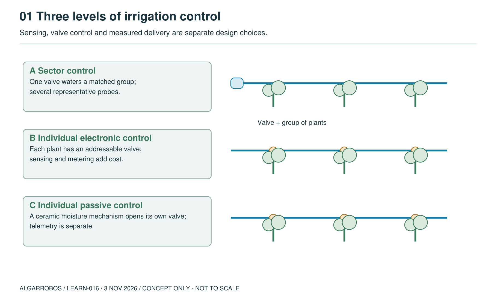

### What Almeria contributes

Almería offers a strong irrigation knowledge and service ecosystem. The useful transfer is the combination of drip hydraulics, representative soil sensing and practical commissioning, rather than copying a greenhouse schedule.

The Cajamar volume *Mejora en la eficiencia del uso de agua y fertilizantes en agricultura* (March 2018) documents local greenhouse irrigation, wireless measurement and sensor-triggered automation. Its chapters explain that probes observe small soil volumes, need representative positions and replication, and can use observations at more than one depth. These chapters describe horticultural conditions; their depths and thresholds should not become native-plant defaults. Relevant PDF pages: 107–129 and 131–141. [Cajamar PDF](https://publicacionescajamar.es/wp-content/uploads/2023/03/mejora-en-la-eficiencia-del-uso-de-agua-2.pdf).

More recent local evidence includes Wise Agrotecnología's advertised wireless measuring points, solar autonomous equipment, soil analysis and sensor-based activation; Edagro's El Ejido service combines matric-tension and conductivity monitoring. These are supplier descriptions, not an independent market census. [Wise solutions](https://www.wiseagrotechnology.net/soluciones), [Edagro monitoring](https://edagro.com/monitorizacion-de-riegos-2/).

For local collaboration, Cajamar's Las Palmerillas experimental station explicitly works on irrigation automation; the University of Almería's ARM group documents an IFAPA greenhouse installation with water-content and conductivity sensing and sector control. IFAPA La Mojonera is another relevant technical institution. These are potential knowledge partners, without any implication of agreement or available support. [Cajamar station](https://www.fundacioncajamar.es/es/comun/estacion-experimental-palmerillas/), [UAL/IFAPA facilities](https://arm.ual.es/arm-group/facilities-and-infrastructures/ifapa-facilities/).

## 2. What exists on the market and in open research

This shortlist represents different purchasing and development routes. An advertised maximum radio range, battery life or plant count is not a design guarantee for a hillside. Get the exact SKU, manual, firmware, replacement-parts policy and local service quotation.

| Family and example | Verified capability or evidence | Fit and limitation |
|---|---|---|
| **Spanish agricultural control: Progrés Agrónic + AgroBee-L** | Irrigation, pumping, sensors and meters; AgroBee-L radio modules actuate latch valves and read inputs; solar options use batteries or supercapacitors depending on model | Strong commercial benchmark for a locally serviceable installation. LoRa modulation does not mean interoperable LoRaWAN. Ask about data export, subscriptions and serviceability. [Controller](https://www.progres.es/es/agronic2500), [radio modules](https://www.progres.es/es/agrobee-l) |
| **Local sensing/integration: Wise** | Wireless field measurements, autonomous solar unit, water meter options and sensor-based irrigation activation | Relevant Almería quote and soil-calibration partner. Check how sensing connects to the actual valve controller and whether operation survives internet loss. [Product/service page](https://www.wiseagrotechnology.net/soluciones) |
| **Local service: Edagro** | Advertises soil tension and EC monitoring from El Ejido | Candidate for installation, advice and maintenance. Full valve automation, API, costs and repair terms require a specific offer. [Service page](https://edagro.com/monitorizacion-de-riegos-2/) |
| **LoRaWAN valve control: Milesight UC511/UC512** | Two DC-latching solenoid outputs and digital/pulse inputs; local rules; UC511 has solar power. A separate soil sensor can participate in the wider system | Useful commercial benchmark for one or two zones. Standard outputs specify two-wire 12 V latch solenoids: do not assume any 9 V valve is compatible. AI variants add specified pressure inputs; a standard unit is not a universal soil-probe reader. [Manufacturer datasheet](https://resource.milesight.com/milesight/iot/document/uc51x-series-datasheet-en.pdf) |
| **Wireless soil measurement: Dragino SE01-LB/LS** | FDR water content, temperature and EC; EU868 variant; battery LB and solar LS versions | Economical architecture candidate to quote. It measures; it does not itself provide the plant valve. Soil-specific checks and service access remain necessary. [Product](https://dragino.com/products/agriculture-weather-station/item/277-se01-lb.html) |
| **Open-source controller: OpenSprinkler** | Eight base zones, expansion, local-only access, flow input; separate AC, DC and latch variants. Manufacturer lists US$130–200 for the product family when checked | Useful local controller or bench reference. Not a complete wireless per-plant system. The listed price is not a delivered Spanish installation price. [Product](https://opensprinkler.com/product/opensprinkler/) |
| **Solar tank kit: Irrigatia Tank Series** | Tank-fed solar pumping, level sensing and garden drip accessories; 60/120/180 marketed irrigation units | Useful simple benchmark for an accessible garden cluster. Its sunlight-responsive approach does not establish per-plant soil feedback or remote telemetry. An irrigation unit is a vendor sizing concept, not a native-tree water requirement. [Range](https://www.irrigatia.com/irrigation-kits/tank-series/) |
| **Passive per-plant valve: Tropf-Blumat** | A water-filled ceramic sensor operates an individual drip valve without electricity; replaceable components | Particularly relevant low-electronics comparator. Observe actual water and maintenance; do not assume drought-tapering suitability without testing. [Manual PDF](https://www.blumat.com/storage/app/media/tropf/manual/Tropf-Blumat_user_manual_EN.pdf) |
| **Urban green-space automation: PlantCare PlantControl CX** | Brochure describes soil monitoring, wired/radio valve modules, alarms and possible autonomous solar-powered modules | Shows that parks and trees already have commercial sensor-control solutions. Brochure is an architectural reference, not a current quote or proof of per-tree metering. [Urban-green brochure](https://plant-care.ch/wp-content/uploads/2023/01/PlantCare-Urban-Green.pdf) |
| **Open research platform: Open_Irr** | Bierer (2023), USDA-ARS: node reads up to 16 Watermark probes and manages four irrigation groups; LoRa node/gateway design, schematics and firmware | Strong grassroots starting point. Published roughly US$250 node cost is historical hardware context, not a 2026 kit price. Original design is 915 MHz and outputs logic signals: European radio and actual valve drivers need engineering. [Paper](https://pmc.ncbi.nlm.nih.gov/articles/PMC10430591/), [author repository](https://github.com/AndrewBierer-USDA/Open_Irr) |
| **Open hardware: CatWAN Farmer** | Electronic Cats publishes LoRa hardware supporting commercial Watermark and DIY gypsum sensor approaches, with solar charging | Useful schematics and learning route. Repository features do not prove current stock, long-term local reliability or an assembled controller service. [Project](https://github.com/ElectronicCats/CatWAN_Farmer) |

An appropriate request to suppliers is: “Quote one complete, independently operating tank cell, with measured delivery, leak isolation, three control sectors, soil commissioning, exportable records, service spares and five-year operating costs.” This gives a fairer comparison than collecting sensor-unit prices.

## 3. Recommended physical architecture

### Use a repeated tank service area

Each service area contains a tank, safe refill point, filtration, manual isolation, pressure provision if required, water measurement, a controller and an energy system. A few sectors or short plant branches serve nearby islands. A shared gateway can supervise multiple tanks. Keep control local so a network outage does not leave the operator unable to close a valve.

The size of a cell should follow terrain, refill access, pipe length, elevation, water budget and maintenance access. Plant count alone is inadequate. A larger dispersed area can use several cells without requiring a radio, panel and battery beside every shrub.

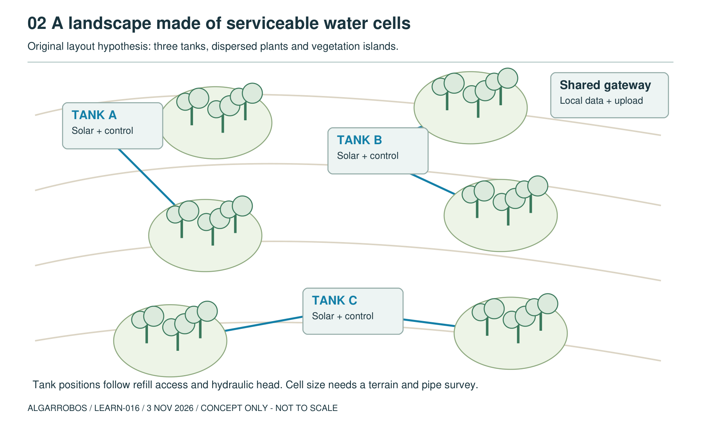

### Three ways to obtain individual control

1. **Valve beside each plant.** Short final water branch, but many exposed devices. Good for a limited research subset or irregular high-value specimens.
2. **A small manifold with one outlet per plant.** Share the controller, battery and radio; run separate microtubes to nearby plants. Check small-tube friction, drainage, filling volume and accessibility. Individual control need not imply individual wireless nodes.
3. **Passive valve at the plant, monitoring at the supply.** Mechanical soil feedback does the routine control; tank/branch meters and sampled probes show behaviour. A branch-level reading cannot identify each plant's exact dose.

For ordinary islands, group species/stock and microsites with compatible support needs into a sector. Do not group plants merely because they are geographically near if their wetting or tolerance needs differ.

### The hydraulic design is the foundation

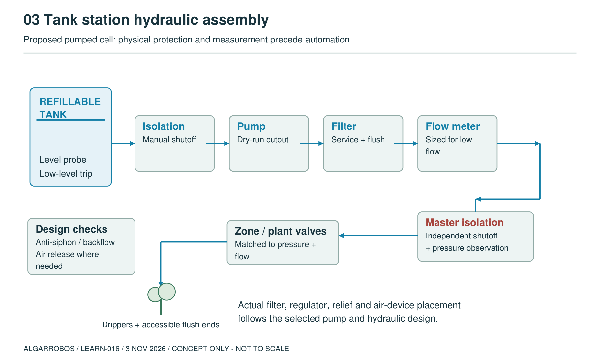

**A ground-level tank will not automatically run a conventional drip installation.** Static pressure is approximately:

`pressure [bar] = 0.0981 × vertical water head [m]`

Two metres of head produces only 0.196 bar before pipe, filter, valve and elevation losses. A component requiring 0.5 bar needs at least 5.1 m of static head before those losses. Design against the tank's lowest operating water level and the highest/most difficult outlet.

For a concrete product example, the Netafim PCJ sheet specifies model-dependent working ranges, including 0.5–4 bar and 0.7–4 bar for relevant variants. Anti-drain configurations have additional opening/closing characteristics. “Pressure compensating” does not mean “works at any pressure.” [Netafim technical PDF, pp. 1–2](https://www.netafim.co.za/globalassets/products/drippers-and-dripperlines/pcj/pcj-dripper-p.pdf).

The options are verified low-pressure gravity components, a tank on suitable natural elevation, or a properly sized pump. A nominally small solenoid valve may rely on differential pressure and minimum flow; obtain curves and test it at the actual pressure and one-plant flow. A motorised ball valve can be an alternative, but operating energy and failure position must be specified. A latching solenoid saves holding power and can remain open after power failure; it is not inherently fail-closed.

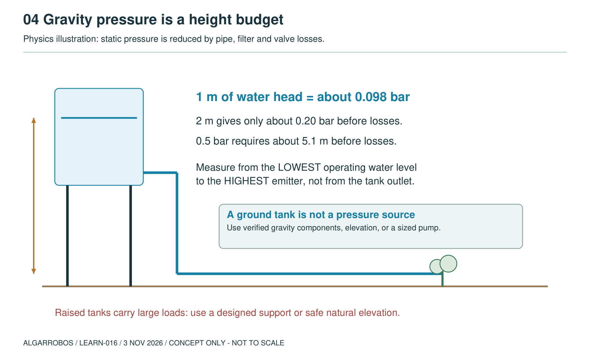

Provide filter access, flush ends, controlled sediment removal and a way to isolate one leak. Inspect water for suspended solids, algae and mineral deposits. Filter requirements come from the selected emitter and water quality, rather than a generic mesh default. Check anti-siphon behaviour on sloping lines and backflow protection at the supply arrangement. A one-tonne water load must not be put on an improvised high stand.

## 4. Sensors and the grassroots development option

### Choose the physical quantity before the sensor

| Measurement | What it tells you | Important limit |
|---|---|---|
| Volumetric water content, VWC | Estimated water volume per soil volume | Soil, density, salinity, temperature and installation affect interpretation; an uncalibrated “30%” can be misleading |
| Matric potential / tension | How strongly the soil holds water | Does not include the osmotic component of salty water; ranges and soil contact matter |
| EC | Electrical conductivity, relevant to salts and sensor interpretation | Bulk-soil EC is not automatically equivalent to irrigation-water or soil-solution EC |
| Temperature | Sensor correction and soil conditions | Useful companion rather than a water-demand prescription |
| Tank level | Inventory and refill warning | Requires tank geometry/calibration; cannot allocate water among plants |
| Flow and pressure | Whether the hydraulic system behaves as expected | Meter minimum flow and pulse resolution must fit the smallest active branch |
| Plant condition and growth | Whether the establishment objective is being achieved | Requires repeatable observations; a soil number alone is insufficient |

IRROMETER distinguishes conventional water-filled tensiometers from granular-matrix WATERMARK sensors. Its troubleshooting guidance shows why a constant wet reading can be a short circuit and an apparent extremely dry reading can be an open wire or poor soil contact. Do not equate an electrical fault with a real drought trigger. Tensiometers measure matric tension; saline water can still create physiological stress. [Sensor overview](https://www.irrometer.com/sensors.html), [technical FAQ](https://www.irrometer.com/faq.html).

**Practical development recommendation:** assemble the node, software and service system locally, initially using a known, replaceable commercial probe as the measurement reference. Add DIY probes in parallel as an experiment. This separates “can we build electronics?” from “does this probe reliably tell us when a native seedling needs water?”

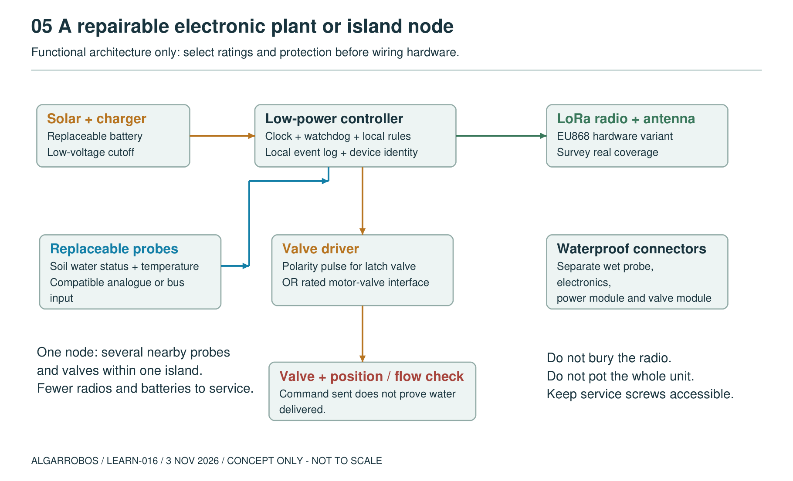

### What can be built cheaply

Candidate routes include low-power microcontroller/radio modules, a replaceable battery, protected power conversion, standard connectors, a valve driver and locally assembled boards. Prefer a node shared by several nearby probes and valve outputs before pursuing a radio at every plant.

Commercial sealed capacitive probes are available, for example Vegetronix VH400 with analogue output. Very cheap exposed resistive boards are more appropriate as teaching or short bench devices than as unverified permanent control sensors. Soil-contact electronics, cable seals, corrosion, condensation and temperature need testing. [VH400 specifications](https://www.vegetronix.com/Products/VH400/).

There is real evidence for improving inexpensive measurement. Nandi and Shrestha (11 September 2024) compared four sensor types across three soil textures. Adding an external ADC improved the tested low-cost sensors; their results do not demonstrate multi-year outdoor durability or validation in this parcel's saline/calcareous stony soil. Better digitisation cannot correct a bad seal or unrepresentative location. [Study PDF](https://www.mdpi.com/1424-8220/24/18/5886/pdf?version=1726049298).

DIY gypsum/granular-matrix probes are a plausible educational research strand, reflected in CatWAN Farmer. Locally made ceramic devices are another manufacturing experiment. Both require reproducible materials, calibration, wet/dry cycling and failure detection; they should not immediately become the sole life-support trigger for valuable plants.

### Probe placement can matter more than another decimal place

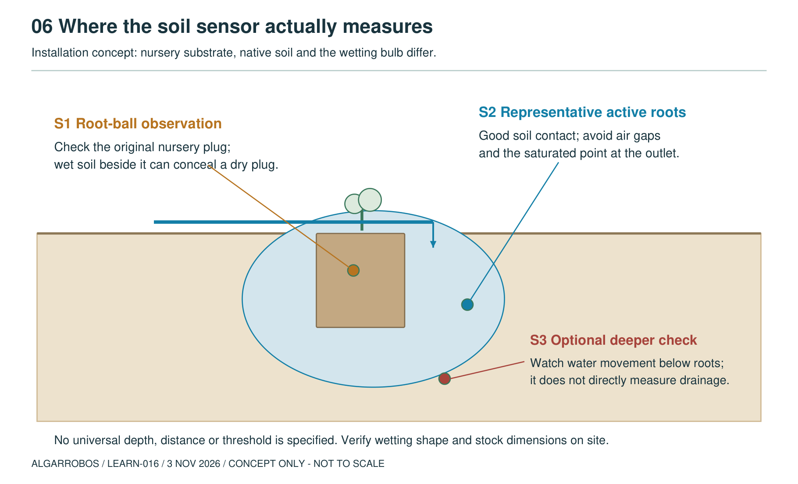

The nursery plug can dry differently from the surrounding native soil. Observe both during commissioning. Locate probes in actual relevant rooting material, with firm contact, away from an air gap and without treating the saturated spot at an emitter as representative of the entire plant. A deeper probe can help reveal a wetting front; it does not directly measure drainage volume or root uptake.

Proposed commissioning: inspect stock and soil, observe a measured wetting event, compare probe changes with direct checks, and repeat across drying cycles. Retain a small reference set of better-characterised probes. Record raw output, units, calibration, temperature, installation position and uncertainty. No species-specific moisture threshold or installation depth is established by this report.

## 5. The especially interesting low-electronics alternative

**Per-plant intelligence does not require per-plant electronics.** Tropf-Blumat uses a water-filled ceramic sensor and mechanical valve. Soil drying changes the sensor's internal pressure; the valve controls a separate drip tube. Water is not delivered through the sensing cone. The manufacturer documents replaceable components and tank operation with a minimum 0.5 m head, recommending at least 1 m. These figures describe that system's instructions, not generic gravity-drip requirements. Manual PDF pages 1–8 cover the principle, supply and setup. [Manufacturer manual](https://www.blumat.com/storage/app/media/tropf/manual/Tropf-Blumat_user_manual_EN.pdf).

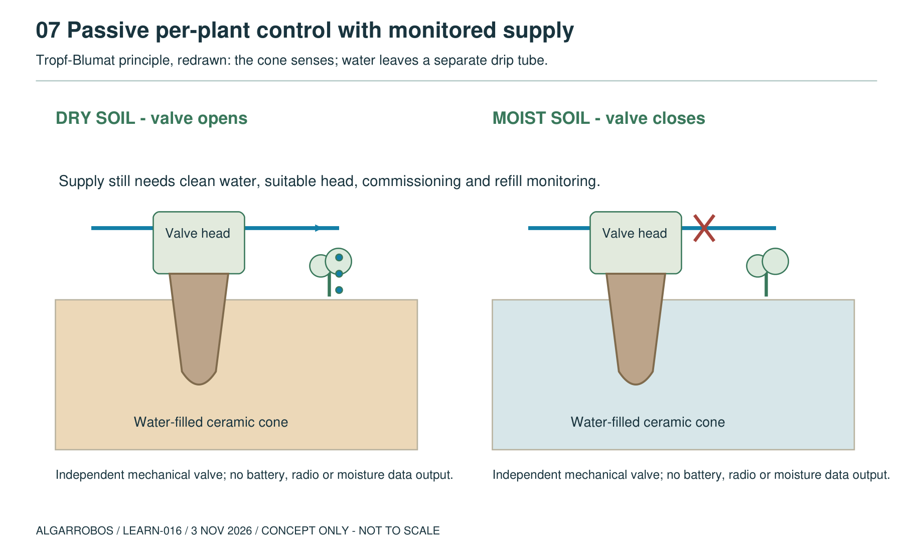

This could pair well with your concept: use the tank station to record level, pressure and actual branch flow, and use a few independent soil probes to evaluate performance. There are fewer batteries to replace. However, commissioning every cone, clean water, suitable head and recovery after running dry still matter. The manual warns that water-starved sensors cease functioning correctly until serviced. Test whether the settings permit the intended establishment/tapering regime. A device intended to maintain garden moisture might supply more frequent water than a restoration protocol intends.

Other options deserve a smaller comparator or later module:

- **Reusable individual reservoirs.** Groasis markets Waterboxx as reusable. Treat its reuse-life statement as a manufacturer claim and measure retrieval, cleaning, breakage and labour locally. [Manufacturer FAQ](https://www.groasis.com/component/ifaq/article/175-using-the-groasis-waterboxx/920-is-the-groasis-waterboxx-re-usable).
- **Biodegradable reservoirs.** LIFE NIEBLAS documents Cocoon establishment, limitations and end-of-life. Its manual reports a 20 L initial reservoir, possible further irrigation in year one, no reuse, and a €7–8 historical unit price excluding shipping/handling; its own project price was €7.80. These are project context, not current Almería quotes. The manual's 49 L/tree summary itself demonstrates why “no irrigation” promotional wording should not become a universal promise. [Technical manual, PDF pp. 93–94 / printed pp. 91–92](https://lifenieblas.com/sites/default/files/documentacion/2024/Techcnical%20Manual%20LIFE%20NIEBLAS%20-ENG_0.pdf).
- **Locally made porous pots or wicks.** Potential pottery/repair workshop activity; evaluate seepage variability, mineral clogging, refill effort and whether reusable retrieval damages roots. This is an author-proposed trial route, not a verified local commercial product.
- **Subsurface/root delivery devices.** Potentially reduce exposed tubing and surface wetting; inspect actual wetting near the nursery plug and provide service access. A deeper outlet is not automatically better for a newly planted small root ball.

Fog harvesting appears in LIFE NIEBLAS but needs an actual fog resource assessment. It cannot be assumed to supply a dry inland Almería parcel. Neither solar pumping nor intelligent control creates water.

## 6. Wireless control, monitoring and intelligent decisions

### A sensible communications hierarchy

Use short wired connections inside an island or tank station, with a radio link between dispersed cells and the shared supervisor. LoRa/LoRaWAN is a plausible low-data-rate option; use the appropriate European hardware and regional settings. Survey coverage with final antenna positions, tanks, terrain and vegetation. Wi-Fi is useful near a service building; cellular/NB-IoT per plant adds a different power and subscription model. BLE is useful for service access or compact sites, but should not be assumed to cover the wider terrain.

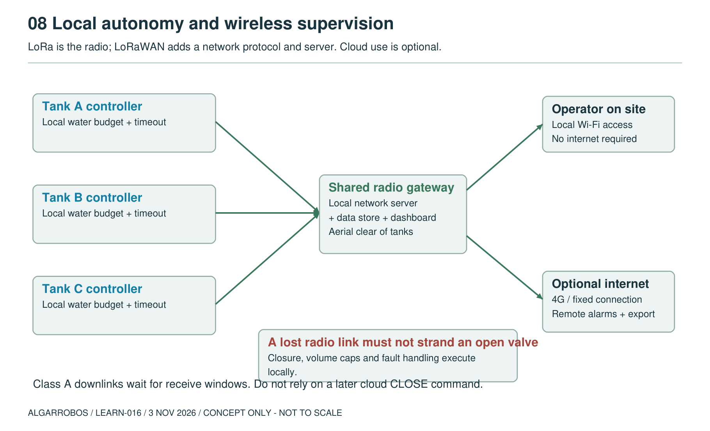

LoRaWAN Class A devices receive downlinks only in windows following an uplink. Immediate remote actuation therefore cannot be assumed for a sleeping node. Execute dose limits and closure locally; a cloud CLOSE message is not the sole safety mechanism. [The Things Network device-class documentation](https://www.thethingsnetwork.org/docs/lorawan/classes/index.html).

A local LoRaWAN installation also needs a network server and application/storage layer, not just a radio gateway. ChirpStack provides an open-source route, including full gateway-OS images; this is a software component to integrate and maintain, not a complete turnkey irrigation product. [ChirpStack setup](https://www.chirpstack.io/docs/chirpstack-gateway-os/getting-started.html), [gateway/server roles](https://www.chirpstack.io/docs/guides/connect-gateway.html).

### Intelligence should be inspectable

Begin with calibrated thresholds, hysteresis, maximum dose/runtime, minimum soak intervals, a per-tank allocation and visible operator review. These are proposed engineering controls. Weather forecasts can advise or defer a planned event when the agreed plant-health rule permits; they should not hide a missing root-zone measurement. Later, use logged data to evaluate predictive scheduling, refill routing and fault diagnosis. Machine learning is a later comparison method, not a prerequisite for intelligent irrigation.

The dashboard should show:

- Plant/island ID, species and establishment cohort; which valve and tank serve it.
- Soil readings with quantity, units, timestamp, calibration and quality state.
- Tank usable inventory, measured consumption, refill history and expected next service date, with uncertainty.
- Valve command, confirmation or uncertainty, pressure/flow response and fault reason.
- Actual measured branch litres separately from inferred per-plant allocations.
- Battery/energy condition, last radio contact and outstanding operator actions.
- Plant condition, deaths, rescue watering and changes in the approved watering protocol.

### Water accounting must match the plumbing

A tank meter proves outflow at that point, not water received by every root ball. It includes downstream leaks and flushing unless these are separated. If multiple plant valves are open together, apportioning total flow is an estimate. Sequential operation can improve allocation only after accounting for pipe filling/drainage, leaks and sufficient meter resolution. For a nominal 2 L/h dripper, a domestic-size meter may be below its accurate operating range. Select metering against the **minimum active flow**, not just the pump's maximum flow.

Possible verification combines branch flow, pressure, periodic catch-can weighing and independent plant observations. “Valve commanded open” is not a successful watering record. Absence of a visible moisture rise alone is also not proof of zero flow: the probe may miss the wetting front.

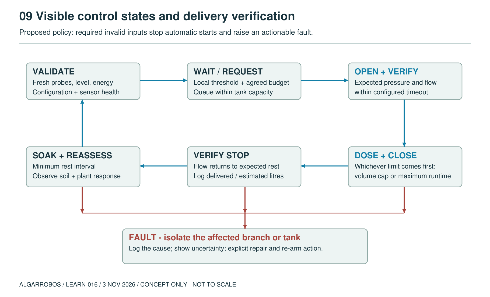

### Explicit failure behaviour

These are proposed requirements for a future implementation, consistent with repository policy:

| Fault | Required visible response |
|---|---|
| Missing or implausible probe, stale timestamp or invalid calibration | Mark the measurement invalid and inhibit automatic starts for the affected control rule; identify what needs inspection |
| Low tank / failed level measurement | Stop or inhibit the affected pump; alert and require refill/inspection |
| Open command without expected flow/pressure | Stop and isolate after a configured timeout; report a hydraulic failure |
| Flow after all outlets should be closed | Isolate via an independently effective master path and report possible leak/stuck valve |
| Low energy / controller restart | Use the engineered closure/energy-reserve strategy and retain event history; never assume latch valves closed themselves |
| Lost radio or internet | Show stale supervision; local protections remain active. A separately documented local mode must not masquerade as live remote control |
| Uncertain delivered volume | Preserve uncertainty; do not replace it with zero or label commanded water as measured delivery |

Fault shutdown protects water and equipment but can endanger plants if nobody responds. Set an operator response plan and a **deliberately activated, logged rescue-watering procedure**. Do not silently switch from failed sensing to a plausible-looking timer schedule.

## 7. Water storage, pumping and solar sizing

### Worked example, not a watering prescription

Assume, solely for arithmetic, one cell serves **40 plants**, an event delivers **5 L per plant**, and a nominal 1,000 L tank has **900 L usable** after a deliberately reserved/unusable 100 L allowance. These inputs are unvalidated design examples.

`event volume = 40 × 5 = 200 L`

`nominal events before reserve = 900 / 200 = 4.5`

That is approximately 31.5 days at one event per week or 15.75 days at two events per week, before flushing, leaks or any increased demand. Schedule refill before the reserve is reached. Four complete 200 L events leave 100 L above the designated reserve; a fifth full event is unavailable without refill. For three such cells, one simultaneous event uses 600 L.

Tank logistics can dominate operating cost. Include source-water price, transport, driving time, pump transfer, hose reach, access after rain and refill availability during heatwaves. A refill warning should use uncertain future demand and a minimum inventory threshold; it must not promise an exact empty date.

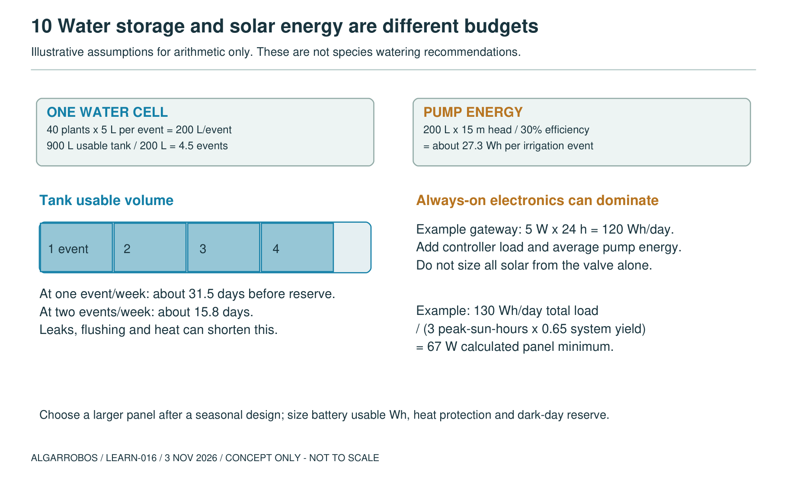

Pump electrical energy from hydraulic work can be estimated as:

`E [Wh] = 2.725 × volume [m³] × total dynamic head [m] / total efficiency`

For 0.2 m³, 15 m total dynamic head and 0.30 total pump/motor efficiency, the example is **27.25 Wh/event**, excluding idle losses and controller/gateway consumption. Total head includes elevation, target emitter pressure and friction. A pump curve must supply both the needed pressure **and** flow; a maximum-flow label at zero head does not establish suitability.

An illustrative always-on 5 W gateway consumes **120 Wh/day**, more than a weekly 27 Wh pumping event. For an assumed total 130 Wh/day, 3 design peak-sun-hours/day and a 0.65 overall PV yield factor:

`panel minimum = 130 / (3 × 0.65) = 66.7 W`

An indicative 100 W selection would still need a seasonal resource, shading, battery and heat review. Three days of this load needs 390 Wh **usable** battery energy; at an assumed 80% usable fraction, that is at least 487.5 Wh nominal, before further ageing/temperature/design margins. These are illustrative calculations, not measured Almería solar inputs or procurement ratings.

Low-power plant nodes may need much smaller energy systems than a gateway. Sharing infrastructure or using replaceable long-life batteries can sometimes avoid the material and service burden of a tiny solar assembly on every plant. If solar-only is a project requirement, apply it explicitly in the configuration and price the complete power chain.

## 8. Cost, local assembly and end of life

### Plan for complete installed systems

The following are **author planning allowances in euros**, not obtained quotations, validated market price ranges or an eligible-cost schedule. They deliberately expose what a “cheap sensor” omits. VAT, shipping, trenching, site access, water and custom engineering are excluded unless listed. Item quantities and specifications must be set before a procurement budget is used.

| Planning component | Illustrative allowance | What must be quoted or resolved |
|---|---:|---|
| Reusable tank, base, plumbing and level arrangement | €200–700 per cell | Provenance, usable volume, safe support, cover and refill access |
| Pump, filtration, isolation, pressure and flow equipment | €250–900 per cell | Actual minimum flow, head, water quality and independent isolation |
| Controller, solar, battery, enclosure and sector drivers | €250–800 per cell | Sleep/idle draw, service parts and closure strategy |
| Robust replaceable soil probe | €40–180 each | Sensor technology, accuracy, calibration and connectors |
| Locally assembled electronic plant node including probe and valve | €90–250 each | Small-batch allowance; excludes development, field installation and validation |
| Passive plant mechanism and immediate fittings | €15–40 each | Supplier quantity quote; excludes common tank, filter and feed pipes |
| Shared gateway/server/comms arrangement | €350–1,000 per site | Outdoor installation and solar supply can add cost |
| Site pipework, installation and commissioning | Site-specific | Route lengths, protections, trenching, tests and training |

The manufacturer-listed OpenSprinkler family price and the historical Open_Irr and Cocoon costs in sections 2 and 5 are separate evidence anchors. They do not validate these allowances.

**Scaling illustration:** 200 plants at an assumed €150 per electronic plant assembly use €30,000 before shared infrastructure, installation, engineering and maintenance. An alternative assumption of ten €300 island control assemblies plus thirty €80 probes is €5,400 for those components. At an assumed €25 passive mechanism per plant, that line is €5,000. These are deliberately partial, unequal-scope arithmetic comparisons; add identical hydraulic/installation/service scopes before judging total costs. They show why the number of complete field nodes matters.

For a 48-plant trial, an initial **€8,000–18,000 discussion envelope** could reserve €3,000–6,000 for installed tank/hydraulic/energy infrastructure, €1,500–4,000 for comparator controls, probes and records, and €3,500–8,000 for design, calibration, commissioning, training, field monitoring and contingency. This is an unquoted scope allowance, not a grant-ready budget; repeated field visits, civil works and product development could exceed it. Obtain both a commercial-installation offer and a local-assembly offer with a named maintainer.

### What could realistically be local

Local work could include irrigation layout and installation, refill/service operations, repair workshops, weatherproof mounting, board assembly, firmware development, soil calibration, locally made ceramics, plant inspections and educational interpretation. Procure standard irrigation fittings and service kits through regional channels where available. Calling the system “locally assembled and maintained” is more defensible than “locally sourced sensors” when semiconductor chips and qualified probes are imported.

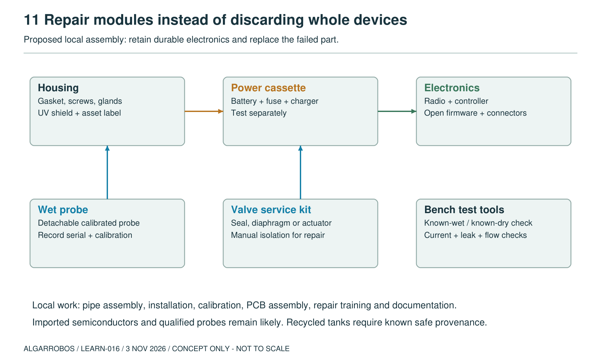

Use screws, accessible gaskets and detachable probe/power/valve modules. Keep batteries replaceable and rated for the actual charging temperature. A shaded, ventilated outer shield can protect electronics without trapping condensation. Do not infer waterproofness from an enclosure rating after adding unqualified glands. Potting a replaceable wet probe may be appropriate; encapsulating the entire controller makes repairs and recycling harder.

Used IBCs are an option only with known safe previous contents and verified suitability, not because they look clean. Reuse radio/electronics at the next planting site after establishment. Label each module and keep calibration, repair and failure records. Budget collection of pipes, guards, labels and damaged electronics. “Biodegradable” and “recyclable” claims need material and actual disposal-route evidence; no such claim is established for a new DIY assembly here.

Compare **five-year total cost**: installed capital + development + subscriptions + water/refill travel + inspections + cleaning + replacements + retrieval/disposal, less defensible reuse value. Report € per surviving established plant alongside litres, paid and volunteer hours, and hardware mass recovered. Water savings without the labour and survival outcomes are incomplete.

## 9. Novelty and a fundable demonstration concept

### What is already established

Commercial sector controllers, wireless soil sensing, solar valve nodes, passive individual valves and open-source moisture automation all exist in the sources above. An application should describe their role honestly rather than claim that wireless per-plant irrigation has been invented for the first time.

### Promising project-specific questions

1. **Minimum useful sensing density:** how many probes and independently controlled outlets are needed for mixed native islands before extra equipment stops paying for itself?
2. **Temporary irrigation with a planned exit:** can the same serviceable cell move to a new island after the first cohort meets a defined establishment criterion?
3. **Passive control plus independent audit:** can mechanical plant valves meet survival and water objectives while shared telemetry reduces maintenance?
4. **Repairable local assembly:** can a trained local team replace probes, batteries and valve parts, with a measured repair time and documented spare supply?
5. **Water allocation under limited tank inventory:** can transparent priorities protect vulnerable plants without concealing shortages or inventing measurement certainty?
6. **Educational value:** can visitors see actual tank use, soil uncertainty and establishment progress, with hands-on repair/calibration activities?

These are hypotheses for a useful demonstrator. Whether they constitute novelty for a particular programme or local territory needs evidence from the programme and local practitioners. This research does not certify patent novelty, market absence or grant selection points.

For the existing AL20 discussion, treat irrigation as a possible work package within a complete native-vegetation demonstration: objectives, deliverables, participants, public benefit, costs, maintenance and evaluation. Relevant documents already in the library include FUND-004/005/008/010/013 and the LEARN-013/014 proposal companions. No existing score, save, funding assumption or design rule is changed by this report.

A larger technology-development proposal could investigate collaborative agricultural innovation or LIFE-style environmental demonstration, but agricultural eligibility cannot be presumed for a restoration park. A park application and a commercial sensor-development venture may have different beneficiaries, public-use conditions and eligible costs. Choose the programme after fixing the applicant, land rights, demonstration scope and operating responsibility; check the live call before making eligibility claims.

Suggested work-package wording:

> Demonstrate and evaluate a repairable, solar-powered establishment-irrigation service for dispersed native trees and shrubs. Compare sector-controlled drip, electronic individual control and passive individual control under documented water budgets. Publish installation concepts, calibration and maintenance procedures, water and survival outcomes, and an equipment reuse and irrigation-tapering plan, supported by local training and public interpretation.

## 10. A proportionate demonstrator experiment

Do not add three irrigation treatments to an existing tiny mulch experiment and claim both questions have been answered. The earlier 12-plant proposal can accommodate hydraulic learning and monitoring, but a technology comparison needs its own replication or a deliberately staged later phase.

### Phase 1: wet bench and small outdoor commissioning

Build one tank cell before planting expansion. Compare candidate valves at the intended minimum head/flow, validate level/flow readings using measured containers, examine wetting around actual nursery stock and test communication from the final locations. Perform controlled fault injections: dry tank, blocked branch, leak, detached probe, stale data, lost network, weak battery and restart with an open latch valve. Record what closes the water, what is detected and what needs a human response. Verify that a repair is feasible with available parts.

### Phase 2: a 48-plant feasibility comparison

Proposed design: four spatial blocks, with three separate four-plant treatment units in each block. Treatments are A: representative-probe sector drip; B: electronically controlled individual outlets; C: passive individual valves with independent monitoring. Randomise the treatment positions within each block. Keep species/stock composition and preparation comparable across treatments; if several species are included, balance them deliberately and limit species-specific claims.

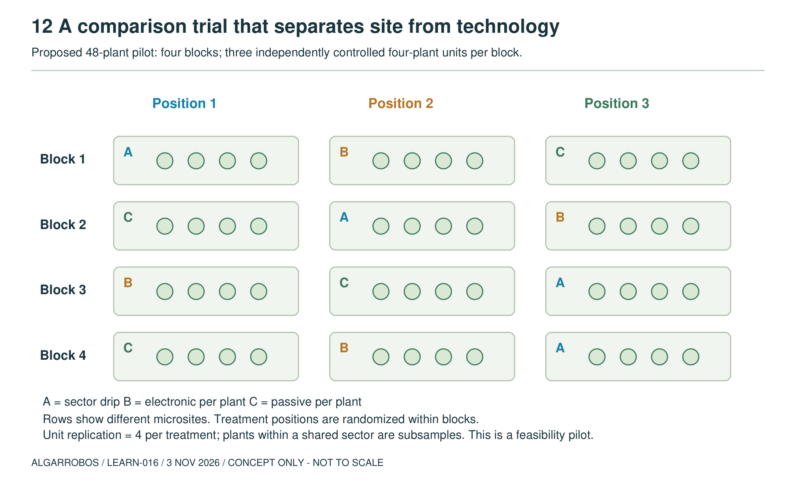

There are **four independent units per treatment**, not sixteen independent sector replicates. Plants sharing a valve are subsamples. Independent downstream branch measurement/control and balanced common-tank supply are required to avoid confounding treatment with tank. Observe pressure differences and prevent runoff transfer between units. A tank shared across all treatments is a common dependency, not additional replication.

This small pilot can test feasibility, gross failures and maintenance, but it cannot establish subtle survival differences or a universal species protocol. If limited to one species it does not answer all shrub/tree questions. A larger follow-on design and sample-size calculation should use the variance, failures and effect sizes observed here.

### Evaluation and stopping rules

Before launch, agree the water cap, rescue-watering criterion, loss threshold, minimum service response, observation dates and planned irrigation-reduction steps with the nursery and site practitioner. Do not invent a universal “stop irrigation after two summers” rule. Follow at least one full dry season and a subsequent tapering review; long-term establishment may require longer observation.

Measure survival and condition, growth where meaningful, delivered water at the stated measurement boundary, plant-dose estimates separately, refill visits, energy, uptime, false alarms, missed watering, leaks, repairs, paid/volunteer labour and retrieval. Publish denominators, rainfall, protocol changes and rescue events. A low-water treatment that kills more plants has not automatically succeeded.

The LIFE NIEBLAS manual offers a useful monitoring precedent with individually identified plants and planting-method comparisons distributed across site variability. Its methods are context, not a compulsory sample size or a survival target for this parcel. [Manual, PDF pp. 167–169](https://lifenieblas.com/sites/default/files/documentacion/2024/Techcnical%20Manual%20LIFE%20NIEBLAS%20-ENG_0.pdf).

## 11. Decisions needed before a purchase or application budget

| Required information | How it changes the design |
|---|---|
| Surveyed planting positions, elevations and refill access | Number of cells, gravity feasibility, pump head and pipe routes |
| Species, actual nursery stock and planting season | Relevant root-ball observation and establishment objectives |
| Soil depth, texture, stoniness, infiltration and retention | Probe technology, installation, sector grouping and wetting approach |
| Water source, reliable volume, EC/hardness and contaminants | Whether the scheme is feasible; filters, cleaning and salt management |
| Permitted water use and land/installation permissions | What supply and infrastructure may actually be operated |
| Routine and emergency staffing | Useful autonomy, refill reserve and acceptable fault response |
| Radio survey and data access requirements | Gateway position, local network, backhaul and subscriptions |
| Exact valve/probe/controller variants | Electrical, hydraulic and communication compatibility |
| Repair owner and replacement-parts route | Whether locally assembled equipment remains maintainable |
| Trial objective and programme requirements | Appropriate comparison scale, public deliverables and budget |

Those are unresolved engineering inputs. No plant moisture threshold, irrigation dose, tank location, solar rating or final supplier is adopted into the simulator or Site Designer by this research.

## 12. Documents to download and library status

**Stored now:** this LEARN-016 report, its Markdown source register and visual guide, the initial 12 SVG/PNG pairs, the illustrated listening companions and their reproduction assets. Section 13.10 lists the drone extension holdings. The previous repository watering and funding documents remain existing local sources.

**Offered for addition:** the external originals below. Temporary research downloads and web citations do not make them permanent library holdings. Follow `CATALOG.md` naming and cataloguing when adding those originals later.

- [Mejora en la eficiencia del uso de agua y fertilizantes en agricultura — Cajamar Caja Rural, Juan Carlos Gázquez coordinator, March 2018 — direct PDF](https://publicacionescajamar.es/wp-content/uploads/2023/03/mejora-en-la-eficiencia-del-uso-de-agua-2.pdf). 238 pages; useful Almería soil-sensing and automation chapters.
- [Tropf-Blumat user manual — Blumat, undated edition checked 3 November 2026 — direct PDF](https://www.blumat.com/storage/app/media/tropf/manual/Tropf-Blumat_user_manual_EN.pdf). 14 pages; individual passive control, head, setup and servicing.
- [Tank Series instructions, batch IRR-5290 — Irrigatia, undated edition checked 3 November 2026 — direct PDF](https://www.irrigatia.com/assets/uploads/pdf/TSV2/Tank-Series-Instructions-5290-V2-UK.pdf). 12 pages; solar tank pumping, level sensing, layout and anti-siphon details.
- [Technical Manual LIFE NIEBLAS — LIFE NIEBLAS partners / GESPLAN, legal deposit 2024, website lists Technical Manual 2025 — direct PDF](https://lifenieblas.com/sites/default/files/documentacion/2024/Techcnical%20Manual%20LIFE%20NIEBLAS%20-ENG_0.pdf). 224 pages; restoration delivery and monitoring. The edition has a verified 2024 legal deposit; a precise publication date was not established.
- [Assessment of Low-Cost and Higher-End Soil Moisture Sensors across Various Moisture Ranges and Soil Textures — Rajesh Nandi and Dev Shrestha, University of Idaho / Sensors, 11 September 2024 — publisher PDF](https://www.mdpi.com/1424-8220/24/18/5886/pdf?version=1726049298). 13 pages, opened as a PDF through the research browser; a separate automated download received HTTP 403, so access may be intermittent. [Open-access article/archive page](https://pmc.ncbi.nlm.nih.gov/articles/PMC11435841/).
- [PCJ Dripper technical sheet — Netafim, undated edition checked 3 November 2026 — direct PDF](https://www.netafim.co.za/globalassets/products/drippers-and-dripperlines/pcj/pcj-dripper-p.pdf). Two pages; variant-specific pressure and filtration.
- [UC51x Series datasheet — Milesight, undated edition checked 3 November 2026 — direct PDF](https://resource.milesight.com/milesight/iot/document/uc51x-series-datasheet-en.pdf). Seven pages; exact outputs, inputs, power and wireless variants.
- [Überwachung und automatische Bewässerung von Stadtgrün — PlantCare, undated brochure checked 3 November 2026 — direct PDF](https://plant-care.ch/wp-content/uploads/2023/01/PlantCare-Urban-Green.pdf). 14 pages; urban-green monitoring and control.

The [full source register](irrigation-research/SOURCES.md) includes dates, evidence roles, local holdings and retrieval limitations. In particular, an indexed Green Link final-report URL now redirects to a domain-sales page; it is not offered here as a working download.

## 13. Drones: surveying, soil moisture and water delivery

Added 3 November 2026. This extension includes **12 sourced reference pictures and eight original technical figures**, numbered 13–20. Photographs and manufacturer renders identify real equipment or experiments; the original schemes explain proposed arrangements. Neither is evidence of performance at the proposed park. [Drone source register, picture credits and retrieval record](irrigation-research/drones/README.md). The illustrated listening edition also contains this material, in chapters thirteen–sixteen.

### 13.1. The practical answer

**Use drones first for mapping and periodic inspection, alongside ground probes and tank-based irrigation.** Test whether multispectral or thermal observations improve decisions beyond an ordinary RGB survey. Treat microwave soil-moisture mapping, robotic probe insertion and airborne watering as distinct specialist experiments. This is an author recommendation from the evidence below, not a claim that a particular supplier has validated the complete system.

| Question | What exists | Implication for dispersed native planting |
|---|---|---|
| Locate and monitor plants? | RGB photogrammetry, orthomosaics, canopy mapping and repeated surveys | Useful first demonstrator layer; small seedlings and obscured plants still need field checks |
| Detect water stress? | Multispectral and thermal cameras; calibrated research workflows | Identify inspection candidates; do not automatically interpret a hot or low-index plant as needing water |
| Measure soil moisture from the air? | Specialist radar and passive microwave radiometry, plus model-based optical estimates | Some approaches retrieve soil-water information; depth, footprint and calibration are instrument/site specific |
| Measure with an inserted probe? | Landing-and-insertion research robots | Direct point measurements are possible, but not a simple flyover and not proven here for stony slopes |
| Read existing soil sensors? | UAV radio data collection demonstrated in field studies | Useful where occasional data collection solves a real coverage problem; watering must operate between flights |
| Carry watering water? | Agricultural spray drones, including verified 40 L and 100 L examples | Physically possible; basin-dose accuracy, operating cost and repeated loads need testing |
| Supply water through a hose? | Orchard spraying prototypes with ground water/power supply | Avoids carrying the entire water supply, but introduces hose handling and flight-control burdens |

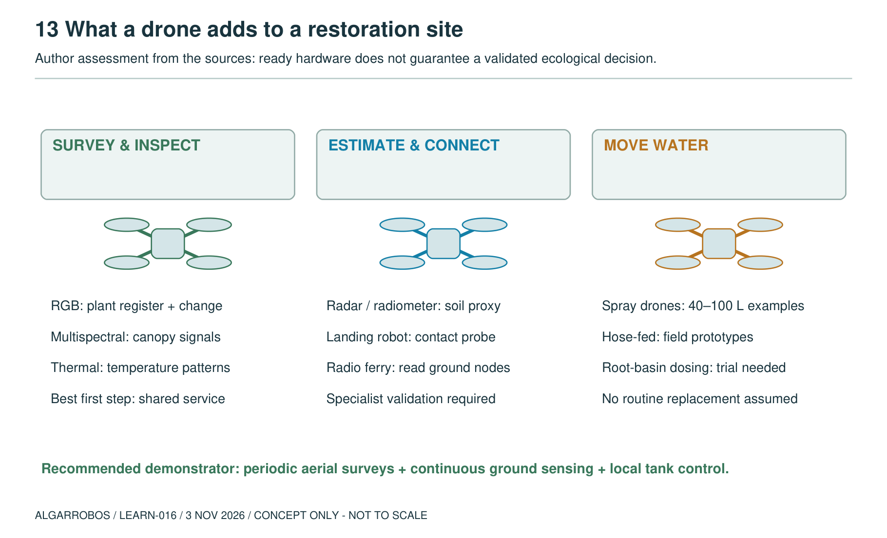

### 13.2. Plant registers, survival and change monitoring

A useful first deliverable is a georeferenced plant register: planted position, unique ID, species and planting date, followed by dated observations of canopy size, visible condition and confidence. Repeated RGB surveys can also document erosion, disturbed basins and vegetation-island development. For our demonstrator, combine this register with emitter/valve IDs and water records; that join is an engineering proposal, not an automatic feature of a camera.

Field evidence cautions against assuming that automated counts equal survival. Forest Growers Research's **RGB ortho-plotting study** examined two recently planted radiata-pine stands. It reported accuracy/recall of 76%/85% for manual annotation and 41%/45% for its automated method. These are study-specific results, not expected Almería performance. Its companion comparison found high-resolution RGB more effective for seedling detection than the tested multispectral imagery, while spectral information showed potential for health assessment. More sensor bands do not necessarily resolve a smaller plant. [FGR, PSP-T014, 28 March 2024, pp. 1, 6–9](https://www.toolsforforesters.co.nz/__data/assets/pdf_file/0005/124925/UAV-Survival_RGB_ortho-plot.pdf); [Singleton, Hartley and Davidson, PSP-T018, 28 March 2024, pp. 6–9](https://fgr.nz/wp-content/uploads/2024/06/PSP-T018_UAVSurvival_Report_Multispectral_vs-RGB_final-1.pdf).

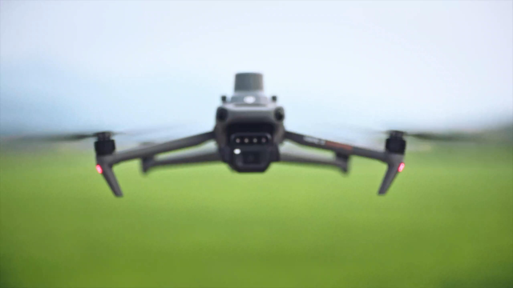

*Reference picture: DJI Mavic 3M, manufacturer's image. An example of an integrated survey aircraft, not a purchase selection. [Source](https://enterprise.dji.com/mavic-3-m).*

For the park, record **alive, dead, missing and unknown/obscured separately**. Keep independent field observations of a representative sample, including difficult small plants. Report false detections and missed plants by species, size, shade and ground cover. A plant hidden by a shrub should not become an invented mortality observation.

RTK improves the positioning of camera observations; it does not create image detail or botanical identification. Specify required ground sampling distance for the smallest target first, then assess flight height, lens, motion blur, terrain and survey time. Use independent check points to test the delivered map's accuracy. Demand the orthomosaic, acquisition date, coordinate reference system, plant table and confidence information, rather than only a colour screenshot.

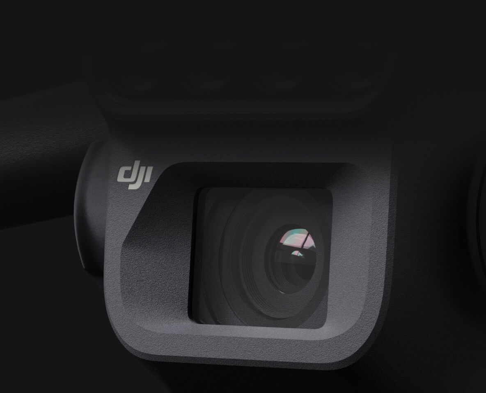

*Reference picture: the Mavic 3M RGB camera. DJI lists a 20 MP RGB sensor separately from its four 5 MP spectral cameras; their images have different spatial information. [Manufacturer specification](https://enterprise.dji.com/mavic-3-m).*

### 13.3. Multispectral and thermal monitoring

Multispectral systems measure reflected light in selected bands. The Mavic 3M example has green, red, red-edge and near-infrared cameras. Such data support vegetation indices and change detection; an index is not a direct reading of litres required, species identity or root-zone moisture. For this project, compare spectral changes within appropriate species/size groups and retain soil-background and seasonal explanations. [DJI Mavic 3M](https://enterprise.dji.com/mavic-3-m).

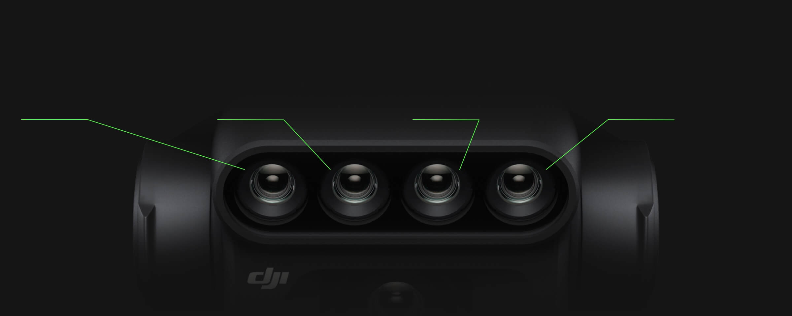

*Reference picture: the four-band array, from DJI. Spectral sensing and the RGB camera perform different jobs. [Source](https://enterprise.dji.com/mavic-3-m).*

Thermal imaging measures surface radiation used to estimate temperature. It can reveal spatial differences associated with water stress, but interpretation needs canopy isolation and relevant weather observations. IFAPA's work with the University of Seville and Agrosap explicitly used controlled irrigation differences to investigate thermal assessment of irrigation uniformity. It is evidence of an Andalusian research workflow, not a ready universal water-stress threshold. [IFAPA, 8 June 2020](https://www.juntadeandalucia.es/agriculturaypesca/ifapa/web/noticias/el-dron-aliado-imprescindible-en-la-investigacion-andaluza).

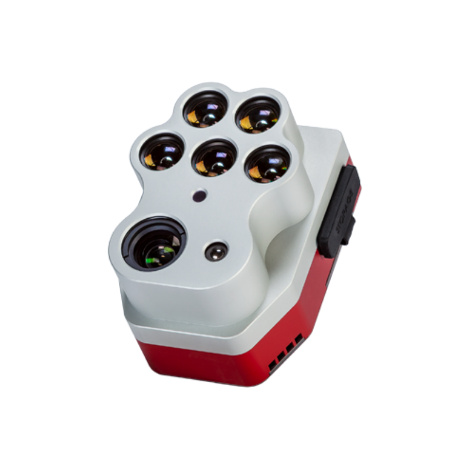

*Reference picture: EagleNXT/MicaSense Altum-PT, an example of a specialist combined payload. [Manufacturer page](https://eaglenxt.com/products/sensors/micasense-series/altum-pt/).*

Resolution is a particular problem for tiny restoration plants. The Altum-PT manufacturer gives **17 cm thermal GSD at 60 m altitude**, alongside much finer pan-sharpened spectral imagery. An **illustrative 20 cm crown** would span only about **1.2 thermal pixels** at that setting, mixing leaves and background. This is arithmetic from a stated camera configuration, not the site's measured crown size or a proposed flight altitude. A thermal map that looks detailed when enlarged cannot recover a clean leaf temperature from such a mixed pixel. [Altum-PT specifications](https://eaglenxt.com/products/sensors/micasense-series/altum-pt/).

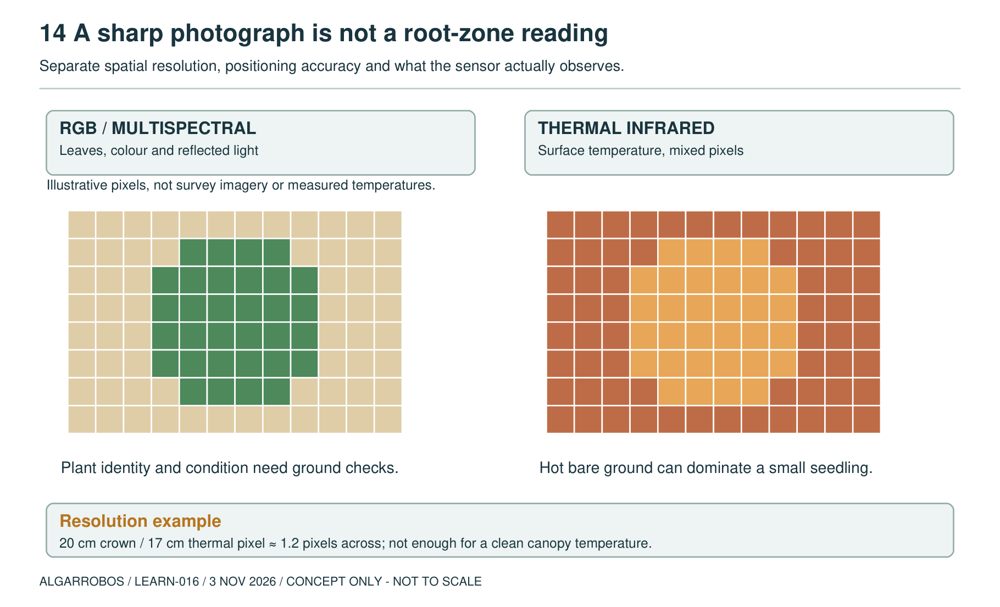

*Reference picture: MicaSense's calibration example. The manufacturer supplies a reflectance panel and light sensor for repeatable spectral acquisition; these do not replace local physiological validation. [Source](https://eaglenxt.com/products/sensors/micasense-series/altum-pt/).*

For the proposed trial, fly comparable acquisition windows and log irradiance/cloud changes, wind, air temperature, recent rain and irrigation. Mask soil and shade where possible. Test thermal or spectral indicators against field-observed stress and moisture, including false alarms caused by small canopy, senescence, disease or different species. This is our proposed quality protocol; no single index cutoff is adopted.

*Reference picture: DJI's Matrice 4 family, including 4E and 4T variants. The thermal-equipped 4T is another commercial route; the family image does not imply that both variants have thermal cameras. [Manufacturer page](https://enterprise.dji.com/matrice-4-series); [official support specifications](https://www.dji.com/support/product/matrice-4-series).*

### 13.4. Can a drone actually measure soil moisture?

**Yes, with qualifications about the measurement method.** Five approaches should be kept distinct:

| Method | What is measured or inferred | Depth / spatial support | Maturity and relevance |
|---|---|---|---|
| RGB, multispectral or thermal model | Reflectance or surface temperature mapped to an estimated moisture/stress variable | Visible surfaces; deeper soil status is inferred | Accessible imaging hardware; local model validation needed |
| Passive L-band radiometer | Microwave brightness temperature inverted for soil water | Usually near-surface, with a footprint far larger than one small plant | Specialist research/precision-agriculture system |
| Active radar / GPR | Electromagnetic response inverted for dielectric properties and water content | Depends on frequency, conductivity, layer model, vegetation and geometry | Demonstrated research; no universal root-depth specification |
| Landing contact probe | A probe physically inserted into soil | A point sample at the actual inserted sensing depth | Research robotic payload; insertion and landing must succeed |
| Radio collection from fixed probes | Digital readings already taken in the ground | The fixed probes' installed depths and sample volumes | Demonstrated communications approach; not remote soil sensing by the aircraft |

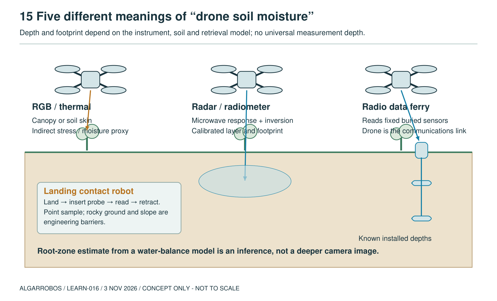

**Passive microwave example.** Monash's SMART Irrigation project describes a UAV L-band radiometer producing top-5-cm moisture maps at 10 m resolution. Its roadmap separately proposes combining those maps with a water-balance model to predict moisture to 60 cm. The latter is a model prediction, not the camera/radiometer directly seeing to that depth. Treat these as project-described capabilities and development objectives. A 10 m cell also cannot distinguish neighbouring individual seedling basins. [Monash SMART Irrigation, ARC LP210301314, undated project page checked 3 November 2026](https://smart.eng.monash.edu/index.html).

**GPR example with a useful limitation.** Henrion and colleagues mapped a Belgian peatland over 19 campaigns at 5 m map resolution. Their temporal correlation with ground sensors was 0.71, but spatial correlation was 0.23; they discuss microvariability and mismatch between sampling positions. The comparison involved a soil layer around 0–35 cm in that particular peat setting. This is evidence that deeper information is possible under a defined model, not proof of equivalent performance in Almería's mineral, rocky or saline soils. [Henrion et al., Science of Remote Sensing, 10 October 2025, pp. 1, 3–5](https://orbi.uliege.be/bitstream/2268/336849/1/_Henrion%20SRS%202025.pdf).

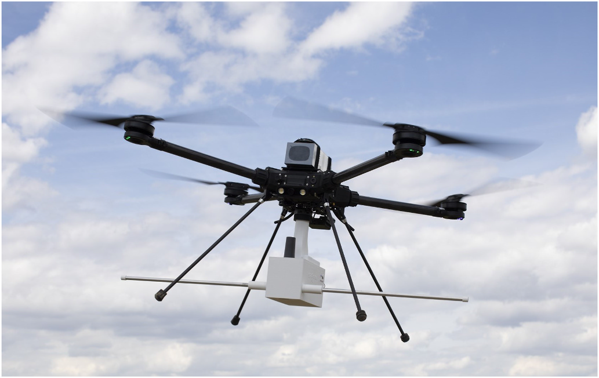

*Research photograph: unaltered photograph panel from Henrion et al., Figure 1(b), PDF p. 3. Specialist radar hardware is visible beneath the aircraft. Source article states CC BY-NC-ND 4.0; authors retain attribution and non-commercial/no-derivatives conditions. [Source PDF](https://orbi.uliege.be/bitstream/2268/336849/1/_Henrion%20SRS%202025.pdf).*

**Emerging through-canopy radar.** The April 2026 GreenScatter preprint reports a physics-based UAV radar method tested in corn and soybean, with an average VWC error stated as 4.49%. That is a reported study result, not a validated Almería error bound. The arXiv record alone does not establish peer-reviewed publication. It is worth following as a research partnership topic; it does not justify replacing root-ball probes in this demonstrator. [Jacobs et al., submitted 10 April 2026](https://arxiv.org/abs/2604.09363).

**Contact robotics.** The DAISY Lab authors' repository documents a UAV payload that lands, inserts a moisture probe, takes three nearby readings, retracts and proceeds. Code and field data are available; the associated publisher article was access-blocked in this research session. This is a real alternative to remote inference, but its transfer to hard, stony, sloping soil needs separate insertion, stability and representativeness tests. [Authors' repository, field trials including July/August 2023](https://github.com/thedaisylab/UAV-soil-moisture-robot); [publisher article landing page, access not verified](https://www.sciencedirect.com/science/article/abs/pii/S0168169924009098).

### 13.5. A drone as a messenger for cheap ground sensors

Singh and colleagues field-tested an aerial data ferry above a roughly 53 ha maize/soybean site, reading stationary soil-water and canopy-temperature stations in 2020–2021. Other work tested UAV collection from buried nodes. These demonstrate collection, not continuous connectivity everywhere. The Nebraska implementation used Campbell RF450 radios; the general idea should not be confused with a verified EU868 LoRa installation. [Singh et al., Sensors, 26 February 2022](https://pmc.ncbi.nlm.nih.gov/articles/PMC8914728/); [Data Collection from Buried Sensor Nodes by Means of an Unmanned Aerial Vehicle, Sensors 22(15), 2022](https://www.mdpi.com/1424-8220/22/15/5926).

For our site, first test a fixed elevated gateway and local store-and-forward logging. Consider aerial collection only if terrain blocks radio coverage or a routine survey flight can cheaply collect otherwise inaccessible logs. Design the radio link, wake schedule, packet acknowledgements, EU radio parameters and missed-visit behaviour explicitly. A periodically visiting drone cannot provide immediate leak alarms when it is absent. Keep tank reserve, maximum dose and dry-run protection in the local station.

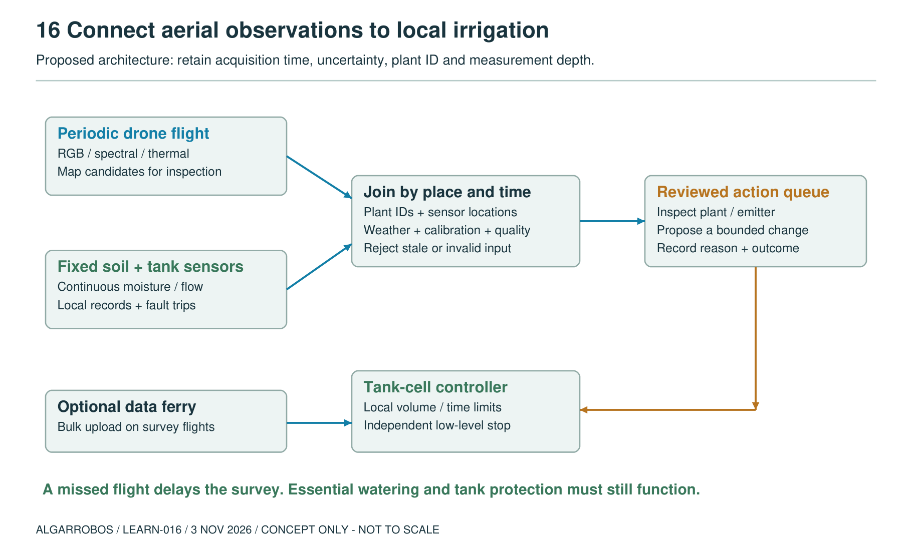

### 13.6. Watering: real aircraft, difficult delivery economics

DJI's T50 manual specifies a **40 L spray tank**, and DJI's T100 product page specifies **100 L**. The latter's regional availability is explicitly limited; neither page establishes a quoted, compliant Spanish installation for this project. These are agricultural spraying examples, not proof of economical root irrigation. [DJI T50 manual, January 2025 edition, pp. 73–75](https://dl.djicdn.com/downloads/t50_t25/20250109/T50_T25_User_Manual_v1.0_EN.pdf); [DJI T100 product page](https://ag.dji.com/t100).

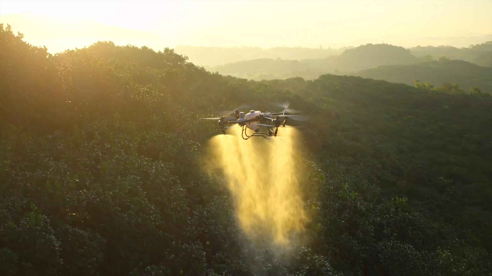

*Manufacturer reference picture: T50 spraying an orchard. The visible spray plume is not a measured dose infiltrating a planting basin. [DJI source](https://ag.dji.com/t50).*

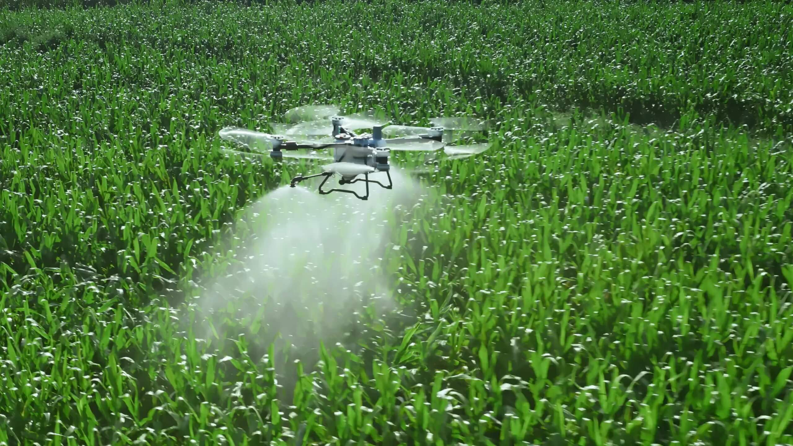

*Manufacturer reference picture: the larger T100 spray platform. Payload growth reduces the number of loads but does not remove refill, charging or root-delivery requirements. [DJI source](https://ag.dji.com/t100).*

Use the earlier report's **illustrative 5 L per plant**, without adopting it as a real dose:

| Water task | Water required | Ideal 40 L loads | Ideal 100 L loads |
|---|---:|---:|---:|
| One 40-plant event | 200 L | 5 | 2 |
| Move the example tank's 900 L usable volume | 900 L | 23 | 9 |
| One 1,000-plant event | 5,000 L | 125 | 50 |

These are rounded-up **payload lower bounds**, not sortie schedules. They exclude unusable residual water, operating reserve, terrain/payload derating, misses, wind losses, refill access, battery work and travel. A load need not equal exactly one safe flight. As a separate unit check, **1,000 L/ha is only 0.1 mm of water**. A large advertised spraying area per hour says little about delivering litres into individual root zones.

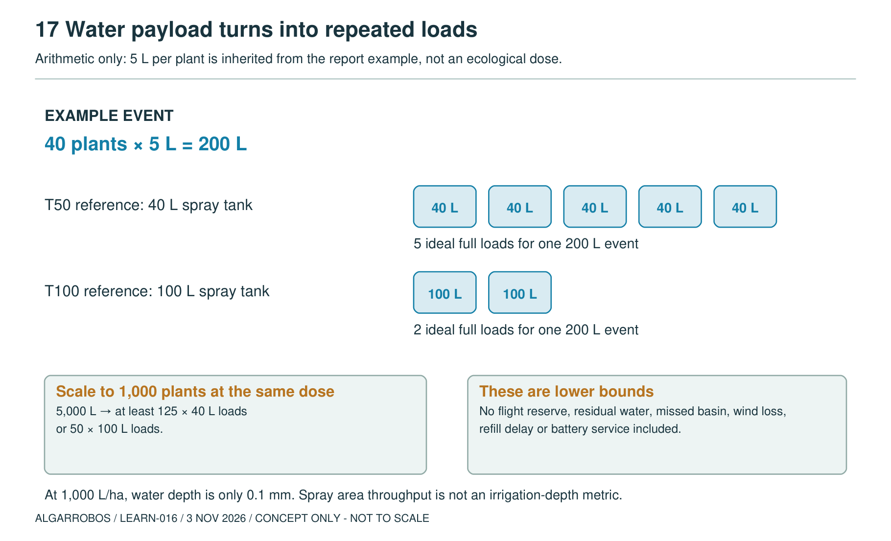

Small solar power for a tank controller should not be extrapolated to heavy-drone charging. The T50 manual lists **1,567 Wh nominal flight-battery energy**. Under the earlier illustrative three peak-sun-hours and 0.65 aggregate yield factor, replacing one such nominal energy amount in one day would require about **0.80 kWp** of PV. This is a sizing illustration, not measured consumption per flight or load; daily flights, charge losses, storage, inverter requirements and charging power need a real duty cycle. [DJI T50 manual, pp. 33 and 98](https://dl.djicdn.com/downloads/t50_t25/20250109/T50_T25_User_Manual_v1.0_EN.pdf).

Our engineering assessment is that normal tank-and-pipe delivery deserves the first comparison position wherever routing is practical. An aircraft might still earn its place for a few inaccessible plants, urgent spot support or a temporary site before pipes are installed. Validate those niches against backpack watering, a vehicle with hose, and temporary lateral pipes. No cost advantage or energy ratio is established by this desk study.

### 13.7. Hose-fed watering and targeted root delivery

Miwa and colleagues field-tested a drone supplied with water and power from the ground in Japanese citrus orchards. Their 2024 paper describes reaction-force control and a ground vehicle assisting hose/cable transport. Results assessed **spray adhesion on water-sensitive paper**, not root-zone replenishment or seedling survival. This is credible evidence of hose-fed water spraying and its engineering burdens; it is not a validated restoration-irrigation system. [Miwa et al., 21 March 2024, pp. 32–35](https://medcraveonline.com/IRATJ/IRATJ-10-00280.pdf).

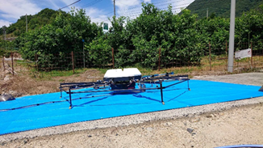

*Research photograph: Miwa et al., Figure 1. [Source article](https://medcraveonline.com/IRATJ/experiments-on-watering-citrus-fruits-with-a-wire-supplied-drone-using-rtk-gnss.html).*

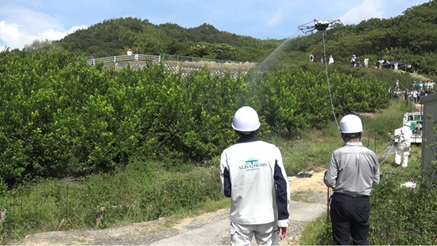

*Research photograph: Miwa et al., Figure 6. [Source article](https://medcraveonline.com/IRATJ/experiments-on-watering-citrus-fruits-with-a-wire-supplied-drone-using-rtk-gnss.html).*

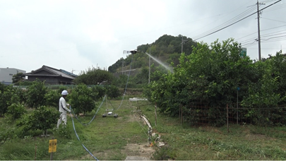

*Research photograph: Miwa et al., Figure 9. The PDF states a Creative Commons attribution/non-commercial condition; no commercial reuse permission is inferred. [Source PDF](https://medcraveonline.com/IRATJ/IRATJ-10-00280.pdf).*

A **proposed** restoration-specific experiment could replace a foliar mist with a metered stream directed into a basin, perhaps using a short drop hose. Before flight, bench-test actual volume, stream breakup, basin interception, infiltration and runoff. Then assess downwash, lateral forces, hose snagging, obstacles and disturbance to mulch/young plants. A ground-fed system also needs a pump, water access and hose management; it does not eliminate the ground infrastructure. The reviewed sources did not establish an off-the-shelf package with validated per-seedling root doses and restoration outcomes for our conditions.

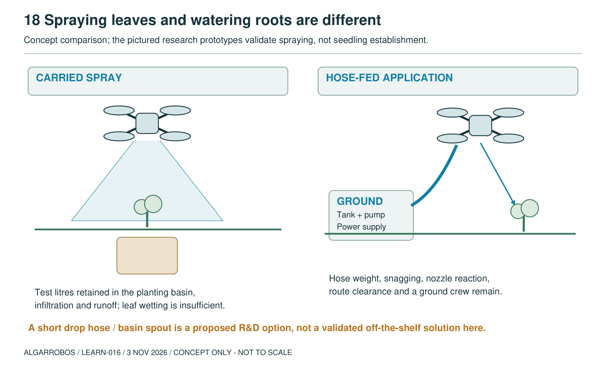

### 13.8. Almería, flight permissions and a realistic local route

The strongest verified nearby precedent is **Andalusian agricultural sensing and irrigation evaluation**, rather than routine drone watering of restoration sites. IFAPA's primary account describes thermal work with Seville/Agrosap. MAPA hosts a presentation by Benito Salvatierra Bellido and Manuel López Rodríguez on satellite/drone methods, including thermography for sprinkler evaluation. UAL also offers geomatic drone training. These establish relevant regional skills; this search did not establish prevalence across Almería parks or a local root-watering drone service. [IFAPA](https://www.juntadeandalucia.es/agriculturaypesca/ifapa/web/noticias/el-dron-aliado-imprescindible-en-la-investigacion-andaluza); [MAPA-hosted presentation, pp. 20–33, publication date not established](https://www.mapa.gob.es/dam/mapa/contenido/desarrollo-rural/temas/gestion-sostenible-de-regadios/documentos/ponencia2.pdf); [UAL, 2025–26 course guide](https://www.ual.es/guia_academica/71261321/2025-26/CAS).

Operationally, **surveying and discharging water need separate assessment**. EASA's open-category guidance includes VLOS, a general 120 m height limit and no dropping of material. The open framework also has mass/class and proximity-to-people conditions; a 40/100 L aircraft should not be treated as a small camera drone. For water-release operations, obtain the applicable AESA specific-category route and assessment from a qualified operator; do not assume an ordinary open-category registration authorises spraying. This is a planning boundary, not a site-specific legal clearance. [EASA open-category FAQ, updated 1 February 2024](https://www.easa.europa.eu/en/print/pdf/node/116450/215572); [current EASA open-category guidance](https://www.easa.europa.eu/en/domains/drones-air-mobility/operating-drone/open-category-low-risk-civil-drones).

Check the actual coordinates and dates in **ENAIRE Drones**, plus applicable environmental/land-manager conditions, public access, protected habitats, aerodrome zones and privacy requirements. AESA's geographical-zones guide explains requirements additional to the operational category. A park may be much less straightforward than an isolated trial plot; a hose does not automatically exempt an aircraft. Nothing here authorises pesticide use or equates clean-water trials with aerial plant-protection treatment. [AESA geographical zones, Ed. 03](https://www.seguridadaerea.gob.es/sites/default/files/UAS-OPR-P01-DT16_Ed.03_UAS.geoghaphical.zones.pdf); [ENAIRE official access and map](https://aip.enaire.es/AIP/UAS-es.html).

### 13.9. Demonstrator, novelty and local repair

Propose a staged work package, with the following **author-designed tests**, rather than promise a fully autonomous watering fleet:

1. **Establish the ground truth.** Add stable plant IDs and dated RGB observations to the existing 48-plant trial. Survey all blocks consistently, while retaining the original four independent irrigation units per treatment. Repeated photographs or multiple plants in a sector do not create extra independent irrigation replicates.
2. **Test additional sensing.** Pair an RGB survey with thermal/multispectral capture and same-day field checks on selected dates. Keep some blocks/dates outside model training. Measure missed stressed plants, false alerts, unclassifiable plants, survey/processing time and useful faults found. Compare against RGB plus the ground sensors already installed.
3. **Test water delivery only behind a clear gate.** Begin with metered basin-delivery bench tests. If a flight experiment is feasible and authorised, record ground-tank withdrawal, retained basin dose, runoff, operator minutes, refill/charging time and wall-energy input. Compare with practical ground watering. Keep this separate from a survival claim until an adequately replicated field trial exists.

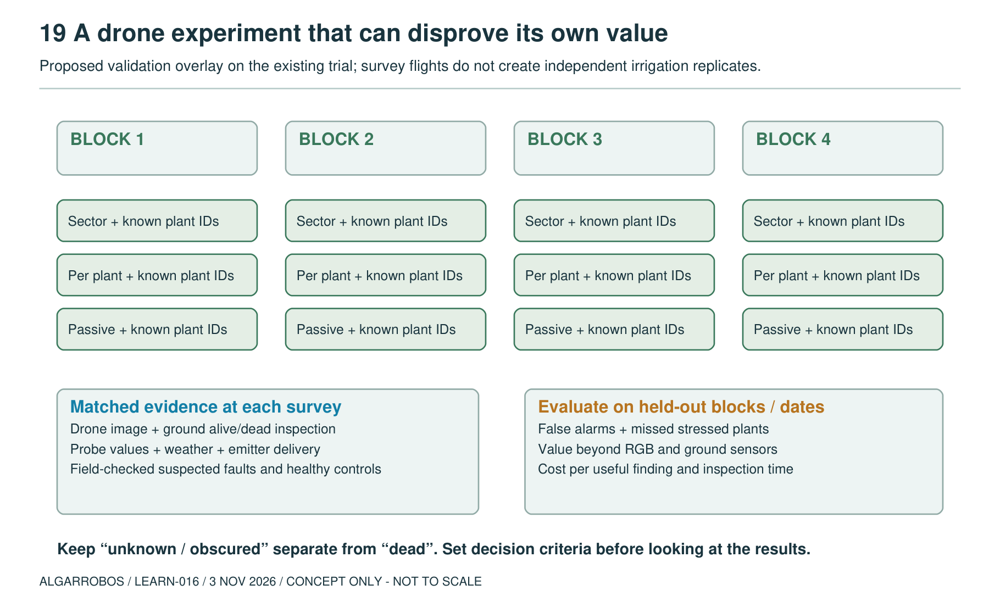

For funding, the promising research question is whether **periodic aerial evidence improves a serviceable native-plant establishment system**: locating failed delivery, prioritising human inspection, and documenting reduced support-water dependence. Radar under sparse native vegetation or a low-disturbance basin nozzle could become separate R&D questions. This landscape scan is not a patent search; none is claimed novel merely because it uses AI, LoRa or a drone.

Local work could include replaceable sensor enclosures, mounts, wiring, test rigs, plant-ID/GIS tools and transparent decision software. Start by borrowing or contracting aircraft with an experienced operator; request actual quotes covering mobilisation, permissions, acquisition, processing, deliverables and repeat visits. Compare total lifecycle service costs before buying. For a small plot, mobilisation may matter more than area-based pricing; that is a budget hypothesis to test, not a quoted market price.

Keep raw photos, calibrated products, coordinate/time metadata and open exports such as GeoTIFF, GeoPackage/CSV and compatible point clouds. Ask suppliers about battery health, spares, propellers, calibration access, firmware support and repair ownership. A locally assembled housing is feasible workshop work; an undocumented flight-critical modification is a different engineering responsibility. Essential irrigation must keep functioning when a drone is grounded, a survey is late or imagery fails quality checks.

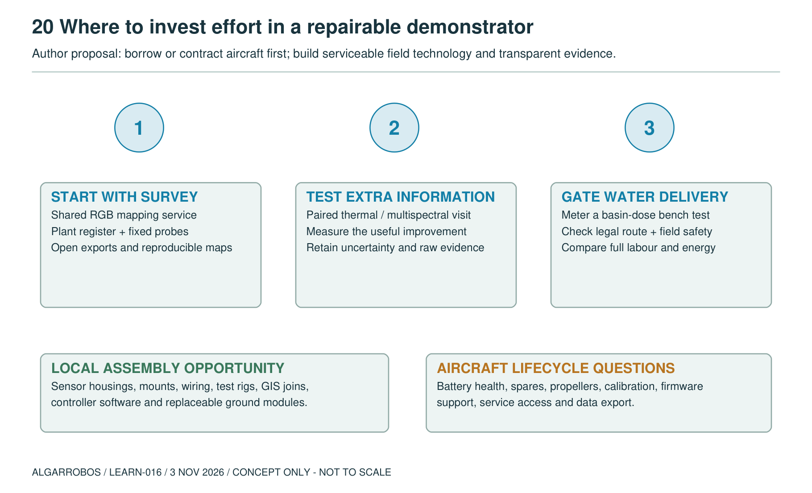

### 13.10. Verified document downloads and library status

**Stored now under LEARN-016:** this extension, eight SVG/PNG figure pairs, twelve source-picture copies with provenance/credits, acquisition/build scripts and the updated illustrated EPUB/Markdown/HTML companions. **External source PDFs are offered for addition; they have not been added as catalogued PDF holdings.** Temporary caches used to inspect them are not library additions. All links checked 3 November 2026:

- [UAV Survival Assessments: RGB Ortho-plotting — Forest Growers Research, PSP-T014, 28 March 2024 — direct PDF](https://www.toolsforforesters.co.nz/__data/assets/pdf_file/0005/124925/UAV-Survival_RGB_ortho-plot.pdf). 10 pages; research browser opened the PDF, while the automated downloader received HTTP 403.
- [Enhancing Survival Surveys: Multispectral vs. RGB UAV Imaging — Blake A. Singleton, Robin J. L. Hartley and Sam J. Davidson / Forest Growers Research, PSP-T018, 28 March 2024 — direct PDF](https://fgr.nz/wp-content/uploads/2024/06/PSP-T018_UAVSurvival_Report_Multispectral_vs-RGB_final-1.pdf). 11 pages; downloaded and parsed for research.
- [Drone-borne ground-penetrating radar reveals spatiotemporal moisture dynamics in peatland root zones — Maud Henrion et al., Science of Remote Sensing, 10 October 2025 — repository PDF](https://orbi.uliege.be/bitstream/2268/336849/1/_Henrion%20SRS%202025.pdf). 17 pages; downloaded and parsed; research browser exceeded its size limit. Peatland-specific evidence, not Almería validation.
- [GreenScatter: Through-Canopy Soil Moisture Sensing with UAV-Mounted Radar — Luke Jacobs et al., arXiv submission 10 April 2026 — direct preprint PDF](https://arxiv.org/pdf/2604.09363). 14 pages; downloaded and parsed. [Stable abstract/version page](https://arxiv.org/abs/2604.09363).
- [Experiments on watering citrus fruits with a wire-supplied drone using RTK-GNSS — Masafumi Miwa, Satoshi Hishida, Keiichi Nishikawa and Masataka Shiromaru, 21 March 2024 — publisher PDF](https://medcraveonline.com/IRATJ/IRATJ-10-00280.pdf). Four pages, journal pp. 32–35; downloaded and parsed. Spray trial, not root-irrigation validation.
- [AGRAS T50/T25 Unmanned Aircraft Flight Manual v1.0 — DJI, January 2025 edition — manufacturer PDF](https://dl.djicdn.com/downloads/t50_t25/20250109/T50_T25_User_Manual_v1.0_EN.pdf). 107 pages; downloaded and parsed. Cover date January 2025; body copyright 2024.
- [Metodología del uso de drones e imágenes satélite para la mejora de la rentabilidad de los regadíos — Benito Salvatierra Bellido and Manuel López Rodríguez / Junta de Andalucía, hosted by MAPA, date not established — direct PDF](https://www.mapa.gob.es/dam/mapa/contenido/desarrollo-rural/temas/gestion-sostenible-de-regadios/documentos/ponencia2.pdf). 33 pages; research browser opened it; automated download failed certificate verification and was not retried with TLS checks disabled.
- [Guide to UAS flight requirements and limitations depending on the place of operations — AESA, Ed. 03, publication date not established — direct PDF](https://www.seguridadaerea.gob.es/sites/default/files/UAS-OPR-P01-DT16_Ed.03_UAS.geoghaphical.zones.pdf). 36 pages; research browser opened it. Check the current official edition before planning flights.

The associated contact-probe article is linked above as a **publisher landing page with access blocked**, not as a verified downloadable paper. The authors' public code/data repository was readable. A separate EASA FAQ print-PDF was indexed with its text/date but returned HTTP 429 on a subsequent direct open; it is not included among the confirmed PDF downloads above.
